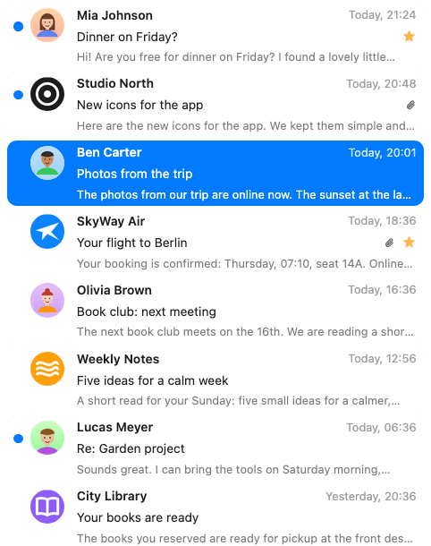
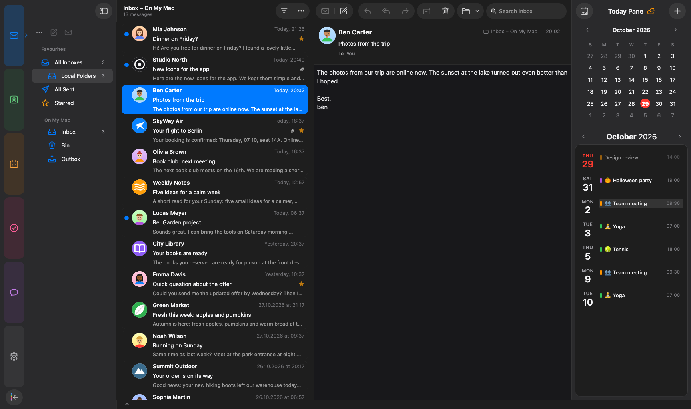
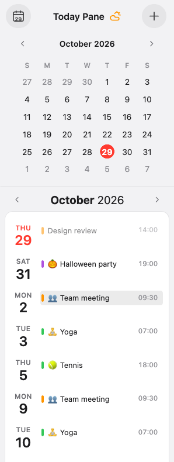
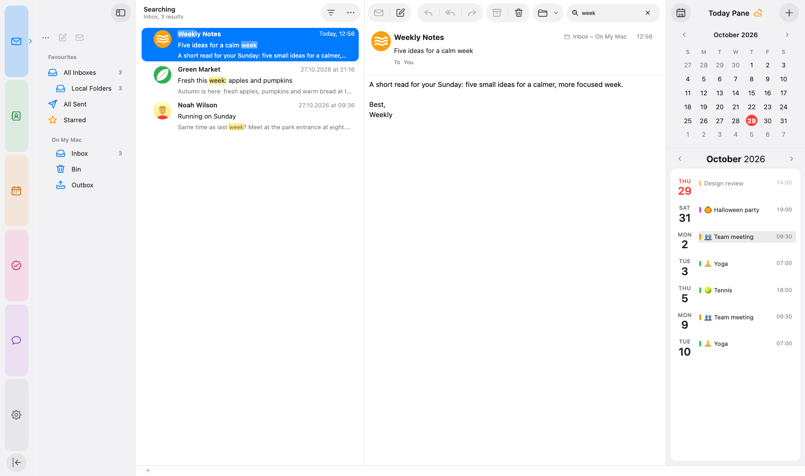
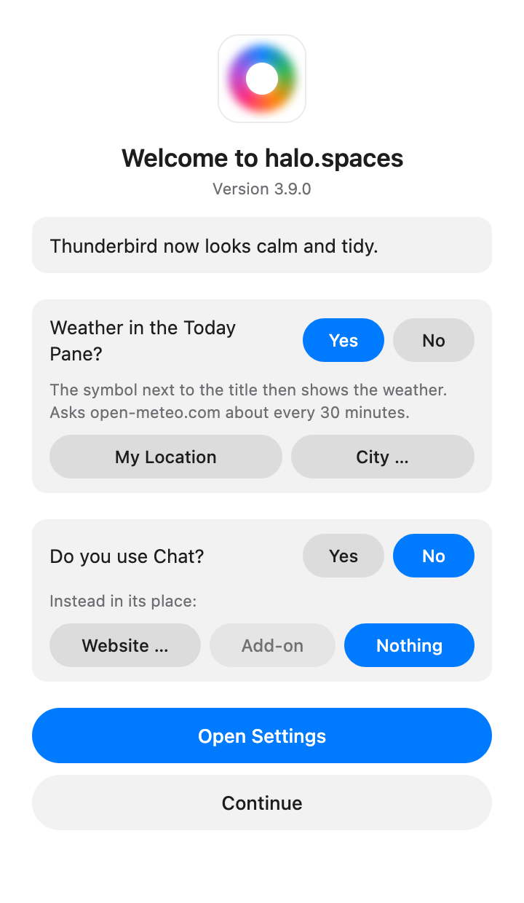

# halo.spaces

<p align="center">
  
</p>

<p align="center">
  <b>A calm, tidy Mac look for Mozilla Thunderbird.</b><br>
  Mail, Calendar, Contacts, Tasks and Chat in one quiet design, with the details that make a mail app feel at home on macOS.
</p>

<p align="center">
  <a href="https://github.com/sruf79/halo-spaces/releases/latest"></a>
  <a href="https://github.com/sruf79/halo-spaces/releases"></a>
  
  
  <a href="LICENSE"></a>
</p>

<p align="center">
  
</p>

<p align="center">
  <a href="https://github.com/sruf79/halo-spaces/releases/latest"><b>Download the latest version</b></a>
  &nbsp;·&nbsp; <a href="#installation">Installation</a>
  &nbsp;·&nbsp; <a href="#whats-new-in-390">What's new</a>
</p>

halo.spaces is **one package** for Thunderbird 153 or newer: the design, its own
clean icons and an extension for everything a theme alone can't do. Install it,
and Thunderbird looks and feels different right away. No restart, no
`userChrome.css`, no settings to hunt for. Updates arrive automatically.

All screenshots show made-up test data.

---------------------------------------------------------------

## Features

### A face for every sender



Every message gets a round sender picture, **automatically**:

- the **photo from your address book**,
- or from the **Contacts app on your Mac** (optional),
- the company's official **BIMI logo**,
- the **icon of the sender's website**,
- otherwise **coloured initials**.

The list shows calm message cards with a two-line preview, time, star and
paperclip. Unread mail can get a light accent tint, replied and forwarded
mail a small arrow. Prefer columns? Switch to a classic table in one menu.

<br clear="right">

### Calm design, light and dark

<p align="center">
  
</p>

- **Light and dark** follow macOS, the **accent colour** follows your system
- **Coloured spaces** on the left: Mail, Contacts, Calendar, Tasks and Chat, all with the same toolbar and sidebar edges
- Its **own icons** throughout: toolbar, folders, menus
- **No scrollbars**: scrolling still works with wheel, trackpad and keyboard
- Sidebars **slide** in and out; drag a divider all the way to close a sidebar, double-click it to reset
- Questions appear as a **sheet** at the top of the window, dialogs without a title bar
- Messages in the **system font**; respects **Increase contrast** in the accessibility settings

### Today pane with weather



The Today pane runs to the top of the window and stays the same in every space:

- the **current weather** as the symbol next to the title, for your city or your location (optional, data from Open-Meteo)
- a **mini calendar**
- an **agenda card** up to the end of the month, with "now" and "in 2 hr" for upcoming events
- a button for a **new event** right in the header

<br clear="right">

### Search that answers right away

<p align="center">
  
</p>

The search field sits top right, like on the Mac:

- results from Thunderbird's index appear **instantly**, also matches **only in the message text**
- a background search then checks the folder and adds mail that isn't indexed yet, **without duplicates**
- it searches the **selected folder**, or **all mailboxes** from a unified folder such as All Inboxes
- the header shows where you are searching and how many results there are
- scrolling through results stays smooth even while a long search is still running

### Mail that helps

- **Undo Send**: take a message back for a few seconds after sending (time adjustable)
- **Send Later**: tonight, tomorrow morning or a time of your choice, from the arrow on the send button
- **Remind Me**: the message comes back unread in an hour, tonight, tomorrow or next week
- **Follow Up**: a gentle note about your own messages that got no reply
- **Whole conversations**: received mail and your own replies from Sent, newest first
- **Filter menu**: hold or right-click the filter button for Unread, Starred, Only from Contacts or Only with Attachments
- **Mailing lists** show a quiet note with Unsubscribe, which disappears once you're out
- **Unified inboxes**, Inbox always first
- A calm **writing window**: symbols-only toolbar, round send button, format bar on demand, attachments as tiles
- **Encryption** at a glance: a clear lock while writing, a quiet lock and seal on encrypted or signed mail

### Calendar and tasks

<p align="center">
  
  
</p>

- Day, Week, Multiweek and Month switcher in the title bar, a **month view without scrollbars**
- **Quick event window**: just type, "tomorrow 12:30 for 90 min" or "Fri 9 to 11"; repeat and alerts with custom rules; a double-click in the calendar opens it too
- A clear **event window** with cards for time, location, invitees and calendar, and date and time in one popover
- **Emojis** before event titles (birthday, dentist, training …), with your own keywords
- **Birthdays** from your address books as their own calendar
- **Tasks** as a list with details on the right, filters in a menu
- Calm **reminders** with a calendar icon showing month and day

### One address book

<p align="center">
  
</p>

- All address books in **one list**, duplicates merged, account labels in the account colours
- Contact photos with a **round crop and zoom slider**
- Cards with name or company only, the details on the right

### Your spaces, your order



- **Drag** a space up or down in the spaces bar to reorder it, the others move out of the way
- Don't use Chat? Replace it with **the space of another add-on**, for example your favourite chat or notes add-on, or with **a website** you keep open all day, or with nothing at all
- A short **welcome** after installing asks about weather and Chat, everything else just works
- All options in one place: **Settings → halo.spaces**, next to Account Settings and Add-ons, and found by the settings search

<br clear="right">

---------------------------------------------------------------

## Installation

1. Download the latest `halo-spaces-<version>.xpi` from
   [Releases](https://github.com/sruf79/halo-spaces/releases).
2. In Thunderbird open **Add-ons and Themes** → gear icon →
   **Install Add-on From File…** and choose the file.
3. That's it. The design is active right away, no restart needed.

On first install halo.spaces sets **Themes** to **System theme – auto**
(Thunderbird's default), so light and dark follow macOS. Thunderbird's Light or
Dark stay if you chose one; themes from the add-on store paint their own colours
over the design.

Updates arrive automatically (Thunderbird checks every 24 hours). To check
right away: **Help → halo.spaces… → Check for Updates**.

No `userChrome.css` is needed. An older copy of this theme in your profile's
`chrome` folder takes precedence and would hide updates, so remove it.

### Options

Options that belong to a view are set right there: preview lines under
**View → Preview Lines**, contact photos in the list's **…** menu, and the
Birthdays calendar with its checkbox in the calendar list. Everything else is
in **Settings → halo.spaces** (also via **Help → halo.spaces… → Settings…**).
Changes take effect right away unless noted.

---------------------------------------------------------------

## What's new in 3.9.0

- **Filter menu**: right-click or hold the filter button above the message list to filter by Unread, Starred, Only from Contacts or Only Mail with Attachments; "Filtered by: …" appears under the mailbox name
- **Reorder spaces**: drag a space up or down in the spaces bar; the others move out of the way, and the order also applies to the spaces menu (reset in Settings → halo.spaces → Spaces)
- **New event window**: "More Options…" sits centred below the notes, with Cancel and Add side by side across the full width
- **Encryption**: the lock in the compose window clearly shows when encryption is on, the key expiry notice is a quiet grey bar, and encrypted or signed messages show a calm lock and seal in the message header
- **Chat**: participants with coloured initials, a calmer right sidebar and a proper text field for writing
- **Message list**: paperclip and star sit flush with the time at the right edge of a card
- **Quick Reply** looks like a text field instead of a button
- **Toolbar**: "Restore Defaults" in Customize brings back the halo.spaces layout
- **Search messages** (Thunderbird 160): the result list matches the rest of the design
- **Thunderbird ESR 153**: Send Later finds the drafts folder again, Choose… in the contact photo window opens the file picker, and several small layout differences are fixed
- Requires Thunderbird 153 or newer

See [Releases](https://github.com/sruf79/halo-spaces/releases) for all versions.

---------------------------------------------------------------

## Known issues

- Made for **macOS**. Windows and Linux work, but they aren't the focus.
  Window buttons and some spacing differ there, and you'll see a short note
  on first start.
- The compose window and a few dialogs are only partly themed.
- Report issues via [GitHub Issues](https://github.com/sruf79/halo-spaces/issues). Please include your OS, Thunderbird version and a screenshot.

## Privacy

halo.spaces has no server, no account, no analytics and no telemetry, and it
never sends your messages, contacts or events anywhere. It only goes online
for what you see: sender logos (the sender's domain only, can be turned off),
the weather if you turn it on, a website you chose as a space, and update
checks. Details in the [privacy policy](store/privacy-en.md).

## Development

| Folder/File | Content |
|---|---|
| `chrome/userChrome.css` | theme (mail, menus, dialogs) |
| `chrome/spaces.css` | calendar, tasks, contacts, chat, settings, merged in by `chrome/merge_spaces.py` |
| `extension/` | the extension (manifest, `api/implementation.js`, icons, options) |
| `tests/` | automated checks in a fresh, temporary profile with made-up data |

```bash
./build.sh                       # → dist/halo-spaces-<version>.xpi (includes theme.css)
python3 tests/halo_test.py       # automated checks in a fresh, temporary profile
./release.sh 3.1.0               # version, update URL, runs the tests, writes updates.json
./publish.sh 3.1.0 notes.md      # uploads exactly that package and verifies the hash
```

## Credits

halo.spaces uses the coffee cup from [Noto Emoji](https://github.com/googlefonts/noto-emoji)
(© Google LLC, Apache License 2.0), see `extension/about/NOTICE.txt`. The optional weather
in the Today pane uses data from [Open-Meteo.com](https://open-meteo.com/) (CC BY 4.0).
The layout of this page started from [FluentBird](https://github.com/Deathbyteacup/fluentbird) by Danny King.

Released under the Mozilla Public License 2.0.

---------------------------------------------------------------

Questions or feedback?
In Thunderbird: **Help → halo.spaces… → Send Feedback**, or open an issue here. Enjoy!
