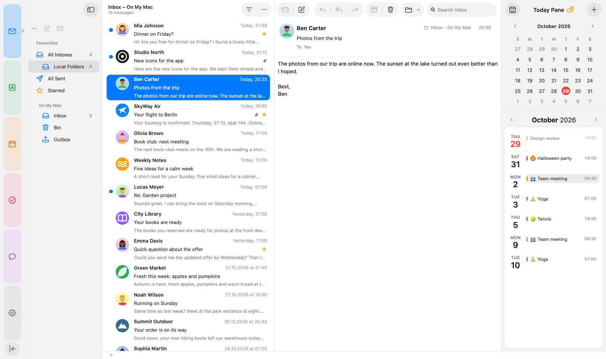
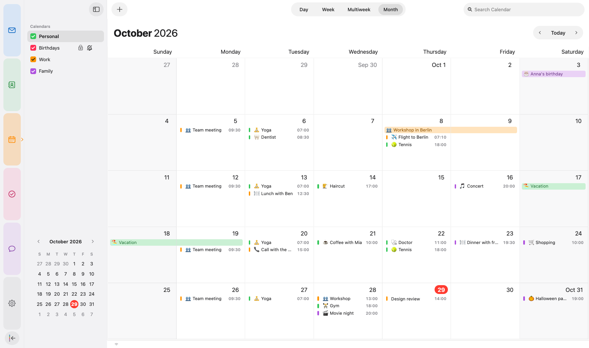
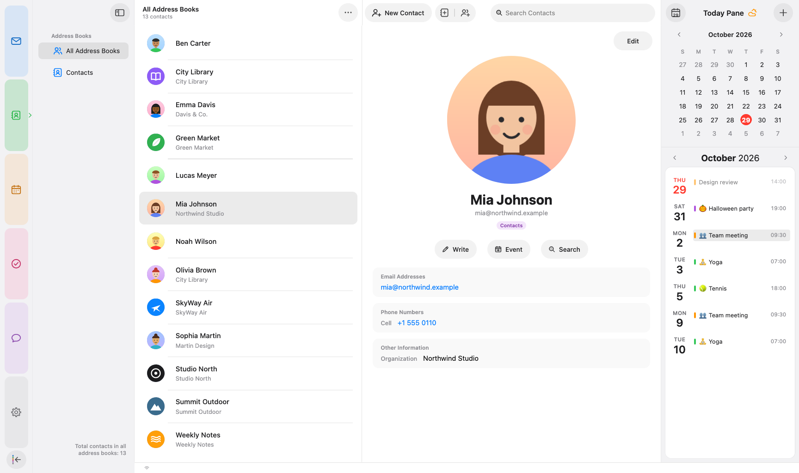
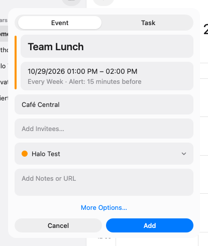

# halo.spaces

<p align="center">
  
</p>

<p align="center">
  <a href="https://github.com/sruf79/halo-spaces/releases/latest"></a>
  <a href="https://github.com/sruf79/halo-spaces/releases"></a>
  
  
  <a href="LICENSE"></a>
</p>

halo.spaces gives Mozilla Thunderbird on macOS a calm, tidy look that fits
right in on the Mac. It adds coloured spaces on the left and uses the same
layout in every space.

It is one package for Thunderbird 153+: the theme, its own clean icons,
and an extension for the things CSS alone can't do.

Released under the Mozilla Public License 2.0

<p align="center">
  
</p>

---------------------------------------------------------------

Features
--------
- **Clean mail layout**: card list with a two-line preview, sender logos (address book, macOS Contacts, BIMI, website icon, otherwise initials), unified inboxes and the search field top right
- **Coloured spaces**: Mail, Contacts, Calendar, Tasks and Chat, all with the same toolbar and sidebar edges. Sidebars slide in and out; dragging a divider all the way closes the sidebar, a double-click resets its width
- **Clear calendar**: Day, Week, Multiweek and Month switcher in the title bar, a month view without scrollbars, and a **quick event/task window** for new entries
- **Today pane**: runs to the top of the window, has a mini calendar plus an agenda card to the end of the month, and marks upcoming events with "now" or "in 2 hr"
- **Unified address book**: duplicates merged, account labels in the account colours
- **Light and dark** follow the system, and the accent colour follows macOS
- No scrollbars anywhere. Scrolling still works with the wheel, trackpad and keyboard
- Automatic updates via GitHub

<p align="center">
  
  
</p>

<p align="center">
  
</p>

All screenshots show made-up test data.

3.9.0 Release Notes
--------
- **Filter menu**: right-click or hold the filter button above the message list to filter by Unread, Starred, Only from Contacts or Only Mail with Attachments; "Filtered by: …" appears under the mailbox name
- **Reorder spaces**: drag a space up or down in the spaces bar; the others move out of the way, and the order also applies to the spaces menu (reset in Settings → halo.spaces → Spaces)
- **New event window**: "More Options…" sits centred below the notes, with Cancel and Add side by side across the full width
- **Encryption**: the lock in the compose window clearly shows when encryption is on, the key expiry notice is a quiet grey bar, and encrypted or signed messages show a calm lock and seal in the message header
- **Chat**: participants with coloured initials, a calmer right sidebar and a proper text field for writing
- **Message list**: paperclip and star sit flush with the time at the right edge of a card
- **Quick Reply** looks like a text field instead of a button
- **Toolbar**: "Restore Defaults" in Customize brings back the halo.spaces layout
- **Search messages** (Thunderbird 160): the result list matches the rest of the design
- **Thunderbird ESR 153**: Send Later finds the drafts folder again, Choose… in the contact photo window opens the file picker, and several small layout differences are fixed
- Requires Thunderbird 153 or newer

See [Releases](https://github.com/sruf79/halo-spaces/releases) for all versions.

Credits
--------
halo.spaces uses the coffee cup from [Noto Emoji](https://github.com/googlefonts/noto-emoji)
(© Google LLC, Apache License 2.0) – see `extension/about/NOTICE.txt`. The optional weather
in the Today pane uses data from [Open-Meteo.com](https://open-meteo.com/) (CC BY 4.0).
The layout of this page follows [FluentBird](https://github.com/Deathbyteacup/fluentbird) by Danny King.

---------------------------------------------------------------

Setup Instructions
------------------

1. Download the latest `halo-spaces-<version>.xpi` from
   [Releases](https://github.com/sruf79/halo-spaces/releases).

2. In Thunderbird open **Add-ons and Themes** → gear icon →
   **Install Add-on From File…** and choose the file.

3. That's it. On first install halo.spaces sets **Themes** to **System theme – auto**
   (Thunderbird's default), so light and dark follow macOS. Thunderbird's Light or
   Dark stay if you chose one; themes from the add-on store paint their own colours
   over the design.

No restart is needed – the design is active right away.

Updates arrive automatically (Thunderbird checks every 24 hours). To check
right away: **Help → halo.spaces… → Check for Updates**.

No `userChrome.css` is needed. The theme ships inside the extension. An older
copy of this theme in your profile's `chrome` folder takes precedence and
would hide updates, so remove it.

---------------------------------------------------------------

Known Issues
------------
- Made for **macOS**. Windows and Linux work, but they aren't the focus.
  Window buttons and some spacing differ there, and you'll see a short note
  on first start.
- The compose window and a few dialogs are only partly themed.
- Report issues via [GitHub Issues](https://github.com/sruf79/halo-spaces/issues). Please include your OS, Thunderbird version and a screenshot.

Options
-------
Options that belong to a view are set right there: preview lines under
**View → Preview Lines**, contact photos in the list's **…** menu, and the
Birthdays calendar is shown or hidden with its checkbox in the calendar list.
All other options – sender logos, photos from the Contacts app, calendar
emojis, dialogs, updates, the bundled design and icons – are in
**Settings → halo.spaces** (also reachable via **Help → halo.spaces… →
Settings…** or **Add-ons and Themes → halo.spaces → Settings**). Changes take
effect right away unless noted.

---------------------------------------------------------------

Development
-----------

| Folder/File | Content |
|---|---|
| `chrome/userChrome.css` | theme (mail, menus, dialogs) |
| `chrome/spaces.css` | calendar, tasks, contacts, chat, settings – merged in by `chrome/merge_spaces.py` |
| `icons/` | toolbar, folder and `--icon-*` replacement icons |
| `extension/` | the extension (manifest, `api/implementation.js`) |

```bash
./build.sh                       # → dist/halo-spaces-<version>.xpi (includes theme.css)
python3 tests/halo_test.py       # automated checks in a fresh, temporary profile
./release.sh 3.1.0               # version, update URL, runs the tests, writes updates.json
./publish.sh 3.1.0 notes.md      # uploads exactly that package and verifies the hash
```

---------------------------------------------------------------

Questions or feedback?
In Thunderbird: **Help → halo.spaces… → Send Feedback**, or open an issue here. Enjoy!
