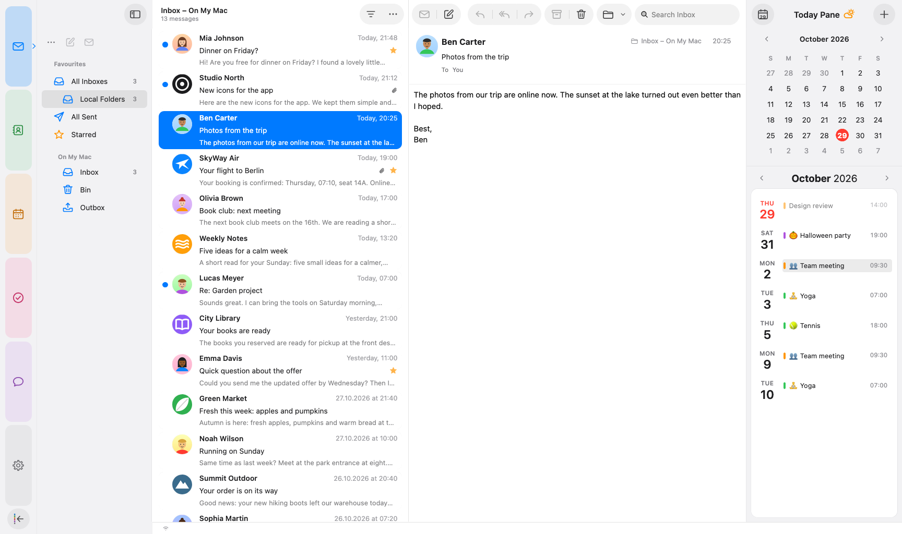
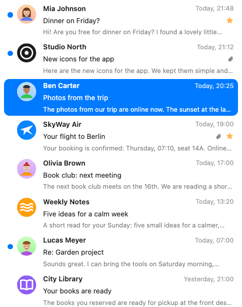
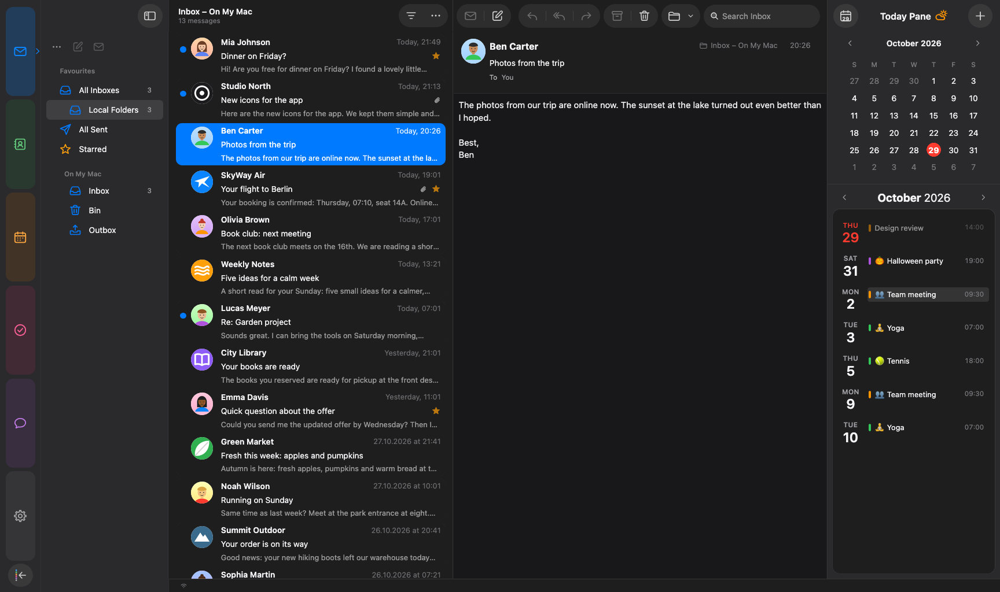
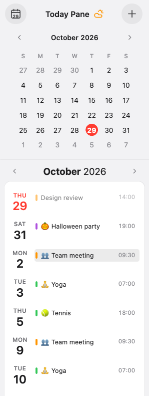
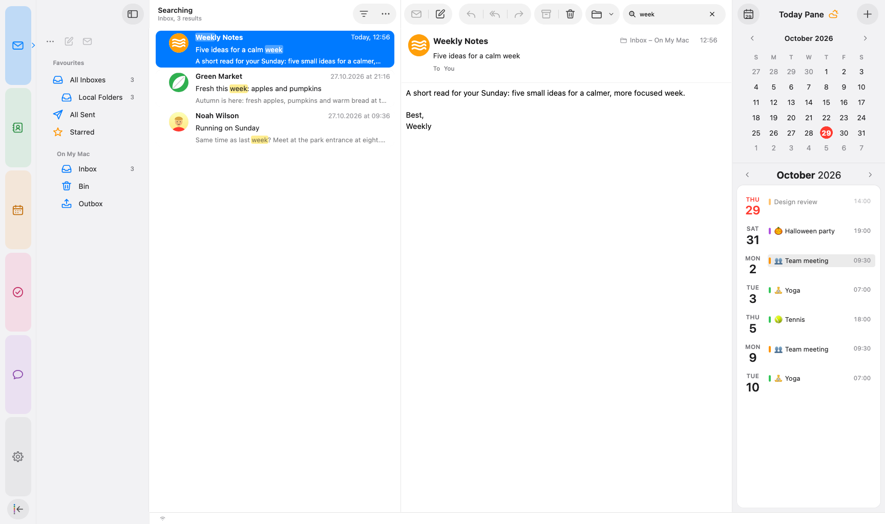
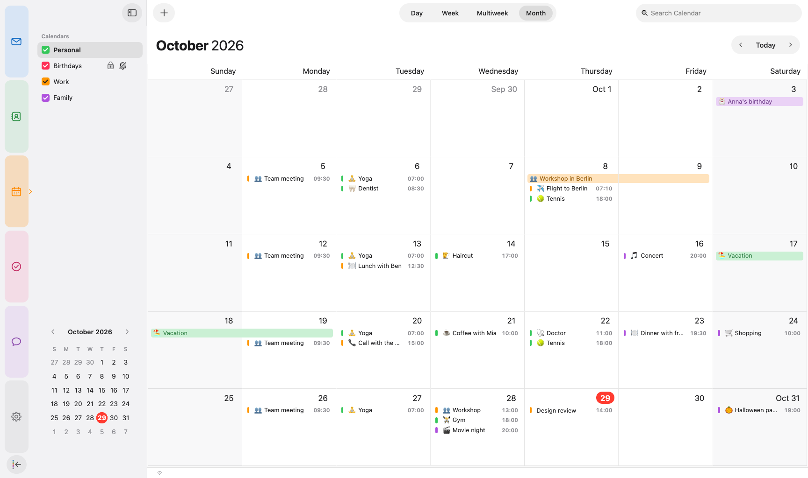
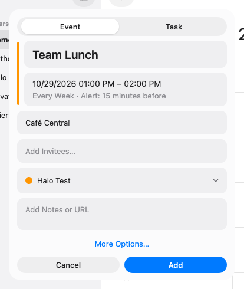
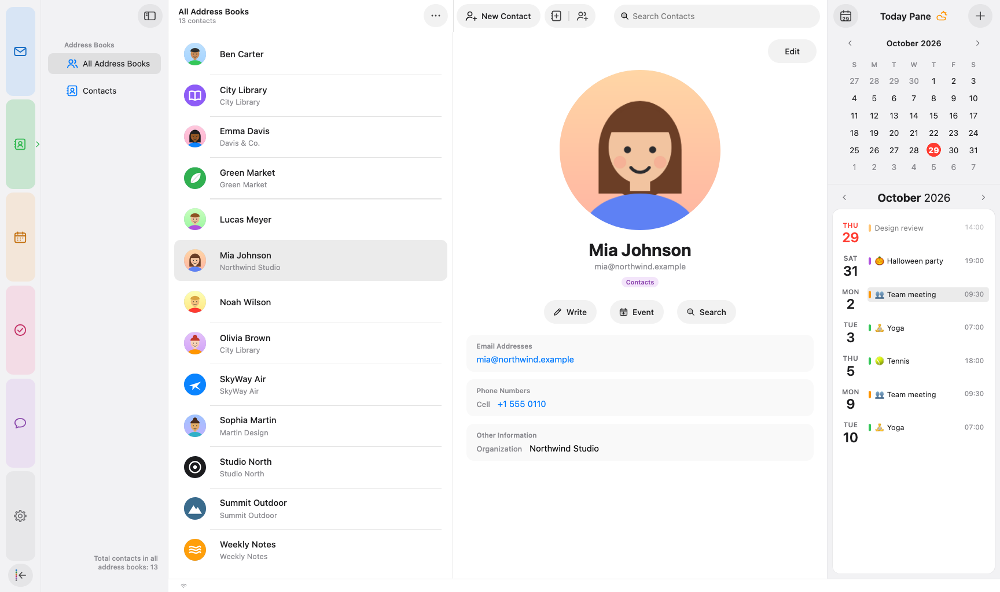
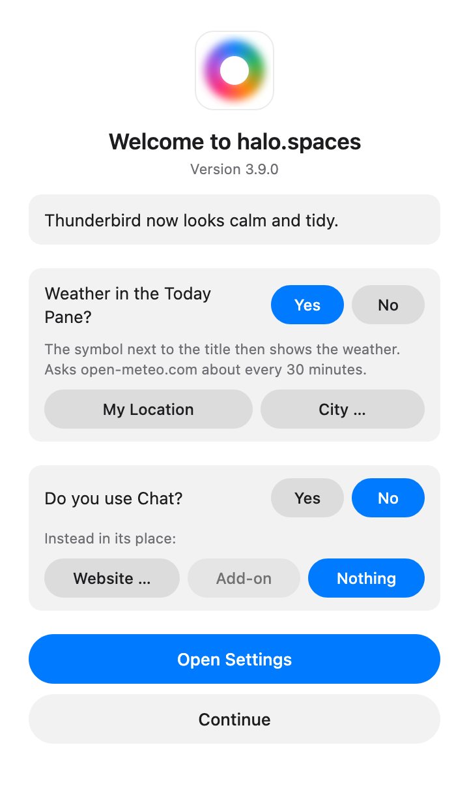

# halo.spaces

<p align="center">
  
</p>

<p align="center">
  <b>A calm, tidy Mac look for Mozilla Thunderbird.</b><br>
  Mail, Calendar, Contacts, Tasks and Chat in one quiet design, with the details that make a mail app feel at home on macOS.
</p>

<p align="center">
  <a href="https://github.com/sruf79/halo-spaces/releases/latest"></a>
  <a href="https://github.com/sruf79/halo-spaces/releases"></a>
  
  
  <a href="LICENSE"></a>
</p>

<p align="center">
  
</p>

<p align="center">
  <a href="https://github.com/sruf79/halo-spaces/releases/latest"><b>Download the latest version</b></a>
  &nbsp;·&nbsp; <a href="#installation">Installation</a>
  &nbsp;·&nbsp; <a href="#whats-new-in-3190">What's new</a>
</p>

halo.spaces is **one package** for Thunderbird 153 or newer: the design, its own
clean icons and an extension for everything a theme alone can't do. Install it,
and Thunderbird looks and feels different right away. No restart, no
`userChrome.css`, no settings to hunt for. Updates arrive automatically.

All screenshots show made-up test data.

---------------------------------------------------------------

## Features

### A face for every sender



Every message gets a round sender picture, **automatically**:

- the **photo from your address book**,
- or from the **Contacts app on your Mac** (optional),
- the company's official **BIMI logo**,
- the **icon of the sender's website**,
- otherwise **coloured initials**.

The list shows calm message cards with a two-line preview, time, star and
paperclip. Unread mail can get a light accent tint, replied and forwarded
mail a small arrow. Prefer columns? Switch to a classic table in one menu.

<br clear="right">

### Calm design, light and dark

<p align="center">
  
</p>

- **Light and dark** follow macOS, the **accent colour** follows your system
- **Coloured spaces** on the left: Mail, Contacts, Calendar, Tasks and Chat, all with the same toolbar and sidebar edges
- Its **own icons** throughout: toolbar, folders, menus
- **No scrollbars**: scrolling still works with wheel, trackpad and keyboard
- Sidebars **slide** in and out; drag a divider all the way to close a sidebar, double-click it to reset
- Questions appear as a **sheet** at the top of the window, dialogs without a title bar
- Messages in the **system font**; respects **Increase contrast** in the accessibility settings

### Today pane with weather



The Today pane runs to the top of the window and stays the same in every space:

- the **current weather** as the symbol next to the title, for your city or your location (optional, data from Open-Meteo)
- a **mini calendar**
- an **agenda card** up to the end of the month, with "now" and "in 2 hr" for upcoming events
- a button for a **new event** right in the header

<br clear="right">

### Search that answers right away

<p align="center">
  
</p>

The search field sits top right, like on the Mac:

- results from Thunderbird's index appear **instantly**, also matches **only in the message text**
- a background search then checks the folder and adds mail that isn't indexed yet, **without duplicates**
- it searches the **selected folder**, or **all mailboxes** from a unified folder such as All Inboxes
- the header shows where you are searching and how many results there are
- scrolling through results stays smooth even while a long search is still running

### Mail that helps

- **Undo Send**: take a message back for a few seconds after sending (time adjustable)
- **Send Later**: tonight, tomorrow morning or a time of your choice, from the arrow on the send button
- **Remind Me**: the message comes back unread in an hour, tonight, tomorrow or next week
- **Follow Up**: a gentle note about your own messages that got no reply
- **Whole conversations**: received mail and your own replies from Sent, newest first
- **Filter menu**: hold or right-click the filter button for Unread, Starred, Only from Contacts or Only with Attachments
- **Quick Look** for attachments: press the space bar in the attachment list or choose Quick Look from its menu (macOS, Thunderbird 158 or newer)
- **Mailing lists** show a quiet note with Unsubscribe, which disappears once you're out
- **Unified inboxes**, Inbox always first
- A calm **writing window**: symbols-only toolbar, round send button, format bar on demand, attachments as tiles
- **Encryption** at a glance: a clear lock while writing, a quiet lock and seal on encrypted or signed mail

### Calendar and tasks

<p align="center">
  
  
</p>

- Day, Week, Multiweek and Month switcher in the title bar, a **month view without scrollbars**
- **Quick event window**: just type, "tomorrow 12:30 for 90 min" or "Fri 9 to 11"; repeat and alerts with custom rules; a double-click in the calendar opens it too
- A clear **event window** with cards for time, location, invitees and calendar, and date and time in one popover
- **Emojis** before event titles (birthday, dentist, training …), with your own keywords
- **Birthdays** from your address books as their own calendar
- **Tasks** as a list with details on the right, filters in a menu
- Calm **reminders** with a calendar icon showing month and day

### One address book

<p align="center">
  
</p>

- All address books in **one list**, duplicates merged, account labels in the account colours
- Contact photos with a **round crop and zoom slider**
- Cards with name or company only, the details on the right

### Your spaces, your order



- **Drag** a space up or down in the spaces bar to reorder it, the others move out of the way
- Don't use Chat? Replace it with **the space of another add-on**, for example your favourite chat or notes add-on, or with **a website** you keep open all day, or with nothing at all
- A short **welcome** after installing asks about weather and Chat, everything else just works
- All options in one place: **Settings → halo.spaces**, next to Account Settings and Add-ons, and found by the settings search

<br clear="right">

---------------------------------------------------------------

## Installation

1. Download the latest `halo-spaces-<version>.xpi` from
   [Releases](https://github.com/sruf79/halo-spaces/releases).
2. In Thunderbird open **Add-ons and Themes** → gear icon →
   **Install Add-on From File…** and choose the file.
3. That's it. The design is active right away, no restart needed.

You only need the `.xpi`. The shell and Python scripts in this repository are
developer tools for building and testing, there's nothing to run.

On first install halo.spaces sets **Themes** to **System theme – auto**
(Thunderbird's default), so light and dark follow macOS. Thunderbird's Light or
Dark stay if you chose one; themes from the add-on store paint their own colours
over the design.

Updates arrive automatically (Thunderbird checks every 24 hours). To check
right away: **Help → halo.spaces → Check for Updates**.

No `userChrome.css` is needed. An older copy of this theme in your profile's
`chrome` folder takes precedence and would hide updates, so remove it.

### Options

Options that belong to a view are set right there: preview lines under
**View → Preview Lines**, contact photos in the list's **…** menu, and the
Birthdays calendar with its checkbox in the calendar list. Everything else is
in **Settings → halo.spaces** (also via **Help → halo.spaces → Settings…**).
Changes take effect right away unless noted.

---------------------------------------------------------------

## What's new in 3.26.0

- **Mail**: double-clicking a collapsed conversation opens one window with its newest message instead of one window per message; the toolbar buttons slide along when you hide or show the sidebar, and the stack of several selected messages slides along with the Today pane instead of jumping at the end
- **Message window**: buttons in the order Archive, Delete, Junk | Reply, Reply All, Forward | More, Star; Reply All is always there, also for messages sent only to you; no second star below the time
- **Sidebar**: dragging the divider below its minimum hides the sidebar and the space tiles together (and brings both back in the same drag) instead of leaving the tiles behind
- **Today pane**: clicking the 1st of a month in the mini calendar moves the list to that day; the circles for today, hover and selection are round and centred on the number
- **Calendar**: the mini calendar sits close to the bottom of the sidebar with a fine line above it; today is marked in a softer red (black number in dark mode)
- **Tasks**: in a task's own window, Complete and More sit in the title bar row again instead of on top of the title; the Kanban view widens the window enough for all three columns, also with the Today pane open
- **Address Book**: the line right of the contact list continues straight into the toolbar row
- **Website as fifth space**: Back, Forward and the address now sit in the toolbar row, so the page starts right below it; the address is display only
- **About**: new "Recommend" button copies a short text with a link to the project page
- Tested with Thunderbird 160; requires Thunderbird 153 or newer

## What's new in 3.25.1

- **Sidebar**: when the sidebar is hidden, it floats in only after the pointer rests briefly at the left edge of the window, so brushing the edge no longer opens it; hiding and showing the sidebar keeps the window buttons in place and moves the buttons above the list along with the edge; in a narrow Address Book window the list of address books slides without jumping, and "All Address Books" keeps its full width
- **Toolbar**: when the window gets narrow, the search field shrinks to the magnifier and stays there until all buttons are back, instead of growing and shrinking as each group makes room
- **View menu**: "Show Status Bar" brings back a hidden status bar
- **Attachments**: the file icon is centred on the file name
- **Reading pane**: the stack of several selected messages is a little smaller and centred
- **Tasks**: in the Kanban view all three columns stay fully visible in a narrow window
- **Address Book**: the circle around "+" of "New" has the same size as in Calendar and Tasks
- **Settings**: a section without options no longer shows an empty heading (#58); "Get Starred Messages" tells you what happened, for example that all starred messages are already available offline
- Tested with Thunderbird 160; requires Thunderbird 153 or newer

## What's new in 3.25.0

- **Sidebar**: hiding and showing the sidebar in Mail, Calendar, Tasks, Chat, Address Book and Settings now moves buttons and spacing along smoothly instead of jumping at the end; dragging the divider no longer snaps back for a moment; with the sidebar hidden, pointing at the very left edge of the window lets it float in again, and it no longer floats in when the pointer leaves a message in the reading pane
- **Tasks**: the buttons of the selected task (Complete, open in its own window, "…") sit in the top toolbar row next to "+", like in Mail; search matches are highlighted in the cards; the Kanban view shows completed tasks in the "Completed" column
- **Calendar**: the multi-week view scrolls smoothly even with many recurring events and no longer shows empty days after a redraw; reminders appear in Thunderbird's own reminder window when the system has no notification service; the event window stays narrow and its menus stay open on Linux
- **Mail**: a selected group header in "By group" shows the group overview again (#57); a message opened in its own tab keeps all toolbar buttons visible at the smallest window width; the stack of several selected messages fills the reading pane; website icons with their own coloured disc fill the profile circle without a ring
- **Toolbar**: the spacing after "Compose" is wide again in a wide window; the faint line under the toolbar while hovering is gone (#55); the divider next to the folder list no longer shifts (#55)
- **Settings**: Appearance is now a choice of three tiles (Light, Dark, Auto); with a custom Thunderbird theme a short hint appears instead of a wrong "Auto" (#55); account settings and add-ons appear as categories at once (#32); "Get Starred Messages" also works in a folder view without a list
- **Dialogs**: confirmation windows such as "Unsubscribe" no longer repeat their heading as the window title on macOS
- **Add-ons**: the Back button shows a single arrow in the add-on's page and its settings (#55)
- Tested with Thunderbird 160; requires Thunderbird 153 or newer

## What's new in 3.24.0

- **Toolbar**: when the window gets narrow, whole button groups make room instead of single buttons, and a "»" button left of the search field offers the actions of every hidden group, in all spaces
- **Tasks**: new Kanban view (via "…" next to the card and table views) with columns Not Started, In Progress and Completed; dragging a card to another column sets its progress. The card view has a new layout with the list colour on the left, the title on top and a progress bar on the right. Double-click, Enter, ⌘O and "Edit Task" open a task in its own window with the same view as the detail column
- **Calendar**: event reminders appear as system notifications with title, time and location, and a click opens the event; clicking the location of an event opens the maps app directly
- **Reading pane**: several selected messages appear as a stack instead of a list
- **Sidebar**: ⌃⌘S hides and shows the sidebar on macOS, like the sidebar button (#56); when the sidebar is hidden, pointing at the left edge of the window lets it float in over the content
- **Settings**: redrawn icons in the sidebar; the category "Chat & More" holds the choice for the fifth place of the spaces bar; "Advanced settings" is the last entry under General and centred; "Get Starred Messages" under Offline works again (it downloads the starred messages of the folder selected in Mail); the link "Show all keyboard shortcuts of Thunderbird" opens again (#56)
- **Mail**: automatically fetched sender logos fill the profile circle without a white ring; more space between the follow-up hint and the first message; message cards no longer show a faint rounded outline, a straight hairline separates them, and grouped lists no longer show a double line; the line between folder list and message list continues in the toolbar row without an offset (#55)
- **Search**: the placeholder of the search field always names the selected folder
- **Add-ons**: the Back button in the page of an add-on shows a single arrow (#55)
- Requires Thunderbird 153 or newer

## What's new in 3.23.1

- **Calendar**: the search field at the top searches events instead of mail; matches by title, location and description appear in the event list below the calendar, and clearing the field closes it again (#53)
- **Calendar and Tasks**: date fields in the event dialog, the quick event window and Tasks follow the system's date format (for example 26.11.2026 instead of 26/11/2026 when the language is English and the region uses dots)
- **Tasks**: the "Open in New Window" button above a task shows its icon again
- Requires Thunderbird 153 or newer

## What's new in 3.23.0

- **Sidebar**: the sidebar button hides and shows the spaces bar and the left column of the space together in one animation (clicking again during the animation reverses it); the separate button at the bottom of the spaces bar is gone. Thunderbird's own ways (View menu, context menu, collapsing the folder pane, dragging) move both halves, and the message list stays still while they slide
- **Mail**: with Gmail, syncing the read status with copies in other labels runs in the background when Thunderbird is idle, so opening a message no longer waits for a search through all Gmail folders (#38)
- **Calendar**: events in Day, Week and Month no longer show a tooltip on hover; a click opens the details
- **Add-ons**: the gear in the page header uses the halo.spaces icon
- Requires Thunderbird 153 or newer

## What's new in 3.22.0

- **Tasks**: the buttons sit above the task in the details column ("Complete" on the left, "Open in New Window" and a "..." menu with Duplicate, Move to List, Open in New Window and Delete Task on the right); the header is an enlarged card with a coloured stripe and a progress bar you can drag, click, type into or change with the arrow keys; the arrow of "Complete" highlights only itself on hover; a list can be renamed in place from its context menu; start and due dates open a month calendar for typing
- **Calendar**: the multi-week view loads further ahead and shows the month name in a band above the week with the 1st while you scroll; clicking the location of an event opens the system's maps app
- **Mail**: the "Follow Up" notice above the inbox is an accent capsule with a small round close button; the Mark menu shows tags under a divider as coloured folders (#50)
- **Settings**: categories ordered by use
- **Toolbar**: the add-on notice sits as a round button next to the Today button (#43)
- **Dialogs**: questions in a small compose window stay inside the window and show all buttons (#45)
- **Today pane**: search field, "+" and title in Tasks glide to their place without jumping at the end
- **Menus**: the active space is ticked in the Window menu (Mac) or under View
- Requires Thunderbird 153 or newer

## What's new in 3.21.0

- **Event dialog**: type the date and time of start and end right in the fields. A click picks day, month, year, hour or minute (highlighted in the calendar's colour) with a small month calendar below the date; digits move on by themselves, Tab and the arrow keys switch fields. The end list below the end time offers the next six half-hour steps with the duration, and an end typed before the start on the same day moves to the next day
- **Quick event window**: date and time of start, end and due date are typed the same way. The window has the same 20 px rounding as other popovers.
- **Tooltips**: every tooltip is the system's own, as on the toolbar, readable in light and dark
- **Dark mode**: all window surfaces share one tone (mail, Calendar, Tasks, Contacts, Chat, Settings, dialogs)
- **Spaces bar**: 88 px wide with evenly spaced tiles; the divider runs from the very top to the bottom
- **Tasks**: "New List" sits right below the last list; the list context menu has no calendar-only commands, "Delete" asks first and names the tasks it removes
- **Add-ons**: Details, Preferences and Permissions are segmented capsules; text buttons, Back, the gear and the magnifier are capsules like the rest; the search fields of the filter list and the saved files are capsules without a border
- **Today pane**: the search field changes its width smoothly while the pane opens and closes; toolbar buttons hidden in a narrow intermediate state come back when there is room again
- **Window menu** (Mac): lists Mail, Address Book, Calendar, Tasks and Chat, which Help search finds as well
- **Settings**: drop-down lists and popovers (Quick event window, "+" in the Today pane, time popovers, "Arrange Attachments") share one surface with the same hairline
- **Fixes**: quick typing in the mail search and fast clicking through a conversation no longer fill the error console; the preview fetch skips messages that were deleted or moved meanwhile; archived, deleted and junk messages disappear at once instead of sliding left first; account rows in the folder list are as tall as the other rows (#44); "OK" in Invite Attendees uses the accent colour and "Busy" is readable in dark mode
- **Search fields**: the magnifier in the search bars no longer gets a grey highlight on hover; search fields in Calendar and Tasks keep their shadow
- **Dialogs and pages**: about:config, Troubleshooting Information, About Thunderbird, the Add-ons header and the OpenPGP key search follow the design (capsule buttons and search fields, accent links, hairlines); buttons in Spelling, Find and Replace, Junk Log, Address search, Recurrence prompt, the account wizards and event reminders are capsules
- **Menus**: "Add Account" and the sender menu when composing use 24 px rows like the other menus
- Requires Thunderbird 153 or newer

## What's new in 3.20.0

- **Rules**: mail filters are now called Rules: "Apply Rules" and "Create Rule from Message…" in the context menus, Mail → "Rules…", a "Rules" window, and a "Rules" card under General in Settings (also found by the settings search)
- **Tasks**: "New List" below the lists (type the name, Enter creates a local list); the list context menu offers "Show All Lists", "New List" and "Add Online List…", also File → New List…; "New Task" below the last card to type a task directly; the "…" menu has Sort By (due date, priority, title, creation date, direction). The title in the details card is centred, the buttons above the details follow the divider when you drag it
- **Toolbar buttons**: grouped buttons show fine separators that disappear on hover; the button under the pointer gets its own rounded highlight inside the group
- **Sidebar** (Mac): the window buttons sit at the top of the spaces bar, and the header above spaces bar and folder list is one surface
- **Say Thanks** in Settings and Help → halo.spaces is a capsule with a golden ring and a steaming cup; the reminder never shows while an update is waiting
- **Today pane**: all toolbar buttons glide to their new place when the pane opens or closes
- **Fixes**: multi-day events can be created again (changing the end no longer moves the start); all attachments of an expanded list are fully visible; an Outlook data file that cannot be read no longer freezes Thunderbird and is released right away; on Linux the main window no longer shrinks under Wayland; "Say Thanks" stays hidden in the welcome window
- Requires Thunderbird 153 or newer

## What's new in 3.19.0

- **Tasks**: edit the open task right in its details column: title, note, location and URL as fields, Start and Due with a date picker and "Remove", menus for Repeat, Reminder, List, Category, Privacy, Priority and Progress (with "Cancelled"); changes are saved at once and can be undone. The whole column scrolls together. "Edit Task…" is now the first entry of the task context menu
- **Archive Account Locally**: its own small window with the account, an overview (folders, messages, estimated size, free space), progress per folder, Stop, and a summary comparing source and archive
- **Conversations**: every message is shown in full, also older read ones, on a light grey background so the cards stand out; the blue frame follows the message you click, and Reply, Reply All and Forward in the toolbar act on that message
- **View → Show with Light Background**: in dark mode, shows the current message with its original light colours; the next message is dark again
- **Today pane**: going back to an earlier month with ‹ shows its latest events first; in Tasks the Today pane has its mini calendar like everywhere else; the search field and buttons glide along when the pane opens or closes
- **Weather**: "Place" is a menu with "Current Location", your recent places and "Choose City…", with the current state below it. If no location is available, "Choose City…" takes you straight to the city search; the weather icon shows the same text instead of "Go to Today"
- **On My Mac** shows Bin and Outbox only while they contain messages
- **Fixes**: calendars no longer stay disabled after starting Thunderbird (halo.spaces asked for them too early, which could leave calendars of other add-ons disabled); folder icons no longer stay black instead of blue; a chosen settings category no longer jumps back to General on slow starts; "Install version …" in Help → halo.spaces keeps its blue on hover; uninstalling also removes the remembered sidebar width
- Requires Thunderbird 153 or newer

## What's new in 3.18.0

- **Tasks**: the open task is shown like an info panel: title and note on a light card, then "Date & Time" (Start, Due, Repeat in short words such as "Every week", Reminder), "Organisation" (List with its color, Category, Privacy), Priority and Progress with the colored ring, and "Place" with a new location icon. Empty values show a grey "None"
- **Today pane**: the list shows the whole month; today stays at the top and earlier events of the month sit above it, slightly faded, when you scroll up. The month list now also works when the Today pane was not ready yet at startup
- **Today pane**: the icon next to the title appears only when the weather is turned on
- **Settings**: "Plugins" under Add-ons shows only when plugins are installed (it led to the recommendations before)
- **Fix**: after an update without restarting Thunderbird, the Today pane no longer shows two suns next to its title
- Requires Thunderbird 153 or newer

## What's new in 3.17.0

- **Reminders** look like a notification: date tile on the left, the calendar's name in small caps above the title, the time ("Today at 09:30") and the location, "Snooze for" and "Dismiss" side by side at the bottom right. The arrow at the top right opens the event in the calendar's month view
- **Calendar**: the week view's title shows just the month and year ("November 2026", across months "Nov – Dec 2026"), so it is never cut off in a narrow window; the full range shows on hover
- **Folder menu**: "Run Filters" for the whole folder and, on the Junk folder, "Erase Junk Mail"
- **Say Thanks**: at the bottom of Settings, with a gentle reminder now and then that goes away on its own
- **⌘1 to ⌘5** open the spaces in the order of the spaces bar, also when you have rearranged it
- **Conversations**: with a collapsed thread selected, Reply, Reply All and Forward in the toolbar work on the newest message instead of being greyed out
- **Compose**: Tab in the subject goes straight to the message text
- **Fixes**: Account Settings and Add-ons no longer go missing from Settings when Thunderbird is slow at startup; the mail toolbar gets its buttons even when an add-on with its own toolbar button is installed; "Install Now" shows in Settings as soon as an update is found; the Today pane in Chat shows the mini calendar and events again; the highlight on "Reply All" stays inside the button; on Windows and Linux the Today button and "+" no longer overlap
- Requires Thunderbird 153 or newer

## What's new in 3.16.1

- **Fix**: "Install version …" in Help → halo.spaces no longer stays on "Installing …" – the update is installed right away and the window closes

## What's new in 3.16.0

- **Tasks, laid out like Mail**: the list is as wide as the message list, "+", Complete, Category, Priority and Delete sit above the open task, which takes the rest of the width (never narrower than its buttons). A continuous divider separates the two, and "No Task Selected" shows when nothing is picked
- **Task folders**: "All" is now "Open" (indigo), in the order Today, Scheduled, Open, In Progress, Completed, Important; In Progress is a ring in the progress colors, Completed is green, Important uses the star, Scheduled shows stacked calendar pages. A task at 0 % has a dashed ring, so it no longer looks done
- **Conversations**: the quoted history at the end of a reply is folded behind "Show More"
- **Search field**: only as wide as its text, in the same place in every space; when it gets narrow, the word "Search" is never cut off, otherwise only the magnifier shows
- **Spaces bar**: finer filled icons for Calendar and Settings, Contacts as a person in a circle, a clearer shadow on the current tile (with a light edge in dark mode)
- **Folder list** follows Thunderbird's density: "Compact" makes the rows lower, "Touch" taller
- **Today pane**: "Go to Today" on the title, the weather icon shows only the weather in words; the title no longer jumps at the end of the animation
- **Help → halo.spaces** without the three dots and with the halo.spaces icon
- **Fixes**: the "…" above the task list stays in place when the window gets narrower; buttons no longer overlap the Today pane header in Tasks; the contact list keeps its width when the address book list is hidden, so the window can get narrower; the Spaces button in Settings no longer lets content shine through; the drop line below the last account is as thick as the others; the halo.spaces icon in Settings has its soft edge back
- Requires Thunderbird 153 or newer

See [Releases](https://github.com/sruf79/halo-spaces/releases) for all versions.

---------------------------------------------------------------

## Known issues

- Made for **macOS**. Windows and Linux work, but they aren't the focus.
  Window buttons and some spacing differ there, and you'll see a short note
  on first start.
- The compose window and a few dialogs are only partly themed.
- Report issues via [GitHub Issues](https://github.com/sruf79/halo-spaces/issues). Please include your OS, Thunderbird version and a screenshot.

## Privacy

halo.spaces has no server, no account, no analytics and no telemetry, and it
never sends your messages, contacts or events anywhere. It only goes online
for what you see: sender logos (the sender's domain only, can be turned off),
contact photos stored as a web link in your address book, the weather if you
turn it on, a website you chose as a space, one-click unsubscribe when you
confirm it, and update checks on GitHub. Details in the [privacy policy](store/privacy-en.md).

Found a security problem? Please report it privately, see
[SECURITY.md](SECURITY.md).

## Development

| Folder/File | Content |
|---|---|
| `chrome/userChrome.css` | theme (mail, menus, dialogs) |
| `chrome/spaces.css` | calendar, tasks, contacts, chat, settings, merged in by `chrome/merge_spaces.py` |
| `extension/` | the extension (manifest, `api/implementation.js`, icons, options) |
| `tests/` | automated checks in a fresh, temporary profile with made-up data |

```bash
./build.sh                       # → dist/halo-spaces-<version>.xpi (includes theme.css)
python3 tests/halo_test.py       # automated checks in a fresh, temporary profile
./release.sh 3.1.0               # version, update URL, runs the tests, writes updates.json
./publish.sh 3.1.0 notes.md      # uploads exactly that package and verifies the hash
```

## Support

halo.spaces is free and made in spare time. If you enjoy it, you can say thanks with a coffee:
[buymeacoffee.com/diversion](https://buymeacoffee.com/diversion) – or in Thunderbird via
**Help → halo.spaces → Say Thanks**.

## Credits

halo.spaces uses the coffee cup from [Noto Emoji](https://github.com/googlefonts/noto-emoji)
(© Google LLC, Apache License 2.0), see `extension/about/NOTICE.txt`. The optional weather
in the Today pane uses data from [Open-Meteo.com](https://open-meteo.com/) (CC BY 4.0).
The layout of this page started from [FluentBird](https://github.com/Deathbyteacup/fluentbird) by Danny King.
Thanks to [Thiago Pedro](https://github.com/ThiagoPedro) for the idea and first version of
accounts and add-ons as items in the settings sidebar (since 3.17.0).

Released under the Mozilla Public License 2.0.

---------------------------------------------------------------

Questions or feedback?
In Thunderbird: **Help → halo.spaces → Send Feedback**, or open an issue here. Enjoy!
