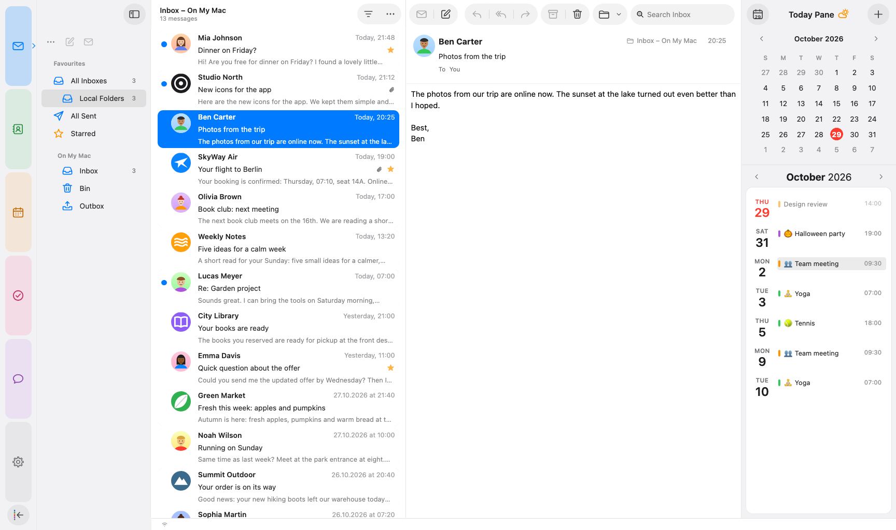
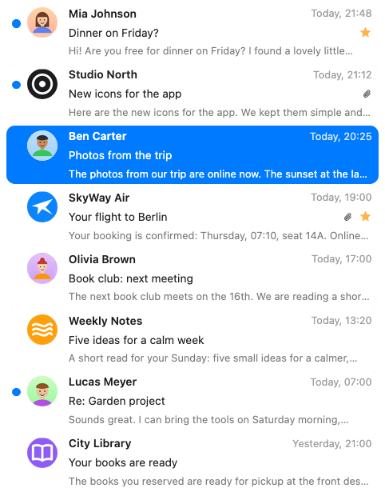
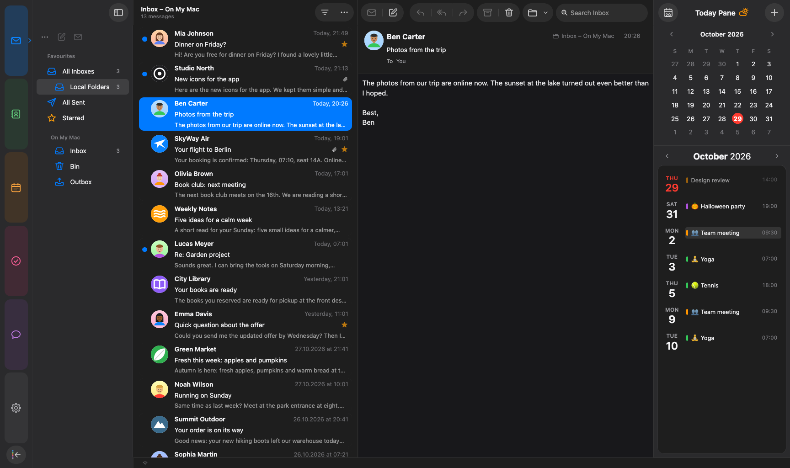
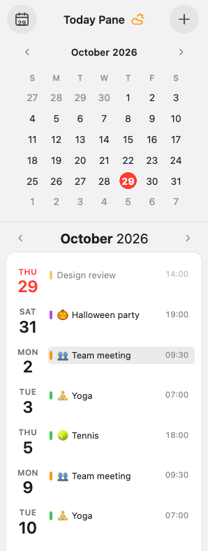
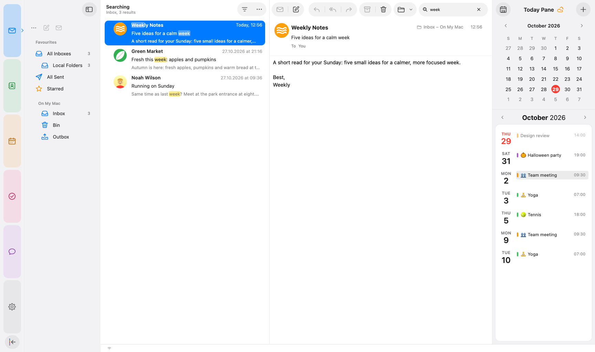
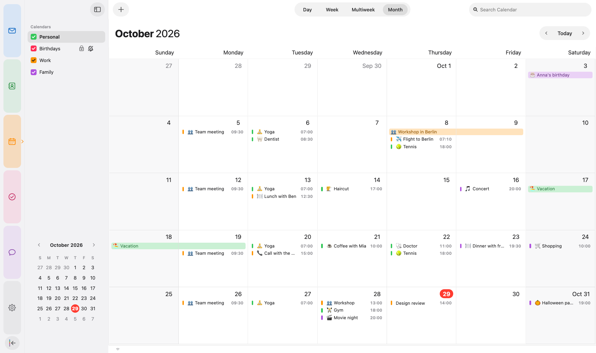
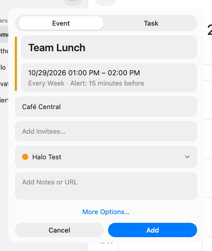
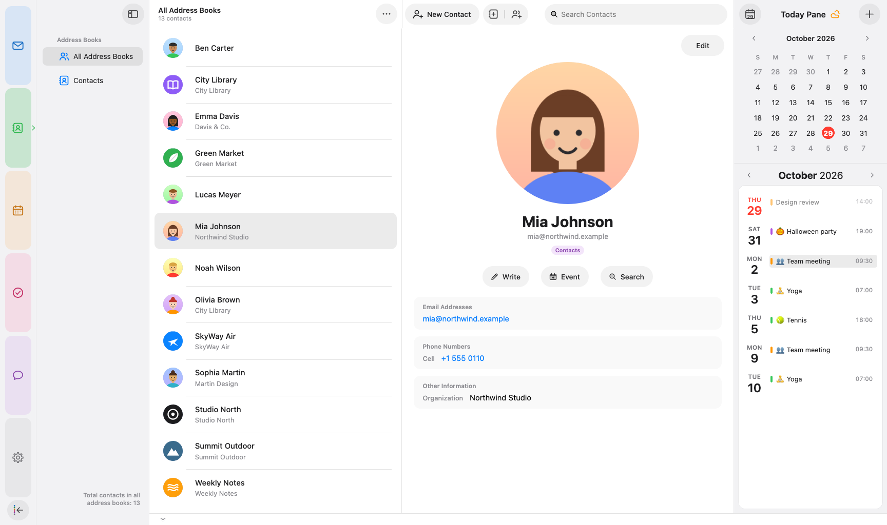
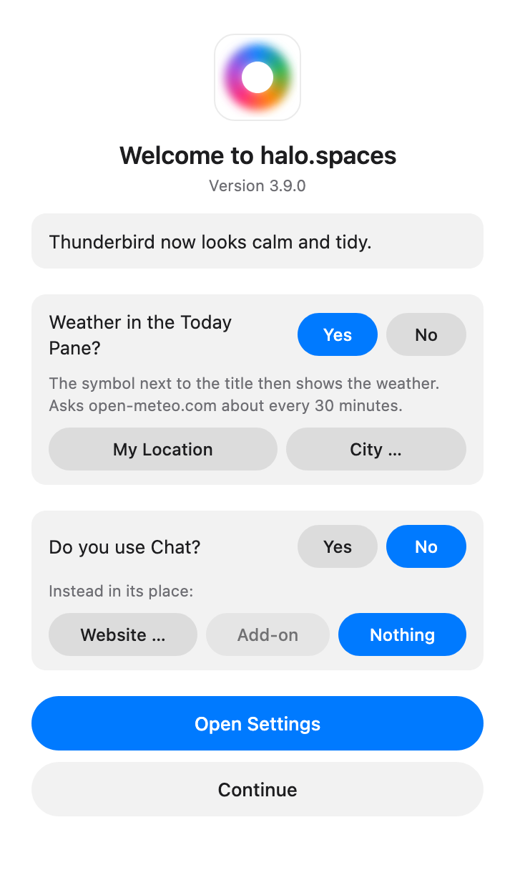

# halo.spaces

<p align="center">
  
</p>

<p align="center">
  <b>A calm, tidy Mac look for Mozilla Thunderbird.</b><br>
  Mail, Calendar, Contacts, Tasks and Chat in one quiet design, with the details that make a mail app feel at home on macOS.
</p>

<p align="center">
  <a href="https://github.com/sruf79/halo-spaces/releases/latest"></a>
  <a href="https://github.com/sruf79/halo-spaces/releases"></a>
  
  
  <a href="LICENSE"></a>
</p>

<p align="center">
  
</p>

<p align="center">
  <a href="https://github.com/sruf79/halo-spaces/releases/latest"><b>Download the latest version</b></a>
  &nbsp;·&nbsp; <a href="#installation">Installation</a>
  &nbsp;·&nbsp; <a href="#whats-new-in-3350">What's new</a>
</p>

halo.spaces is **one package** for Thunderbird 153 or newer: the design, its own
clean icons and an extension for everything a theme alone can't do. Install it,
and Thunderbird looks and feels different right away. No restart, no
`userChrome.css`, no settings to hunt for. Updates arrive automatically.

All screenshots show made-up test data.

---------------------------------------------------------------

## Features

### A face for every sender



Every message gets a round sender picture, **automatically**:

- the **photo from your address book**,
- or from the **Contacts app on your Mac** (optional),
- the company's official **BIMI logo**,
- the **icon of the sender's website**,
- otherwise **coloured initials**.

The list shows calm message cards with a two-line preview, time, star and
paperclip. Unread mail can get a light accent tint, replied and forwarded
mail a small arrow. Prefer columns? Switch to a classic table in one menu.
Attachments sit below the message as tiles with their own save button; verification and sign-in codes appear above the message with a Copy button.

<br clear="right">

### Calm design, light and dark

<p align="center">
  
</p>

- **Light and dark** follow macOS, the **accent colour** follows your system
- **Coloured spaces** on the left: Mail, Contacts, Calendar, Tasks and Chat, all with the same toolbar and sidebar edges; the active tile catches the light with a soft glow in its colour (can be turned off)
- Its **own icons** throughout: toolbar, folders, menus
- **No scrollbars**: scrolling still works with wheel, trackpad and keyboard
- Sidebars **slide** in and out: hide the sidebar with its button or ⌃⌘S; when hidden, rest the pointer at the left edge and it floats in; drag a divider all the way to close it, double-click it to reset
- When the window gets narrow, the search field shrinks to the magnifier and whole button groups move into a » menu
- Questions appear as a **sheet** at the top of the window, dialogs without a title bar
- Messages in the **system font**; respects **Increase contrast** in the accessibility settings

### Today pane with weather



The Today pane runs to the top of the window and stays the same in every space:

- the **current weather** as the symbol next to the title, for your city or your location (optional, data from Open-Meteo)
- a **mini calendar**
- an **agenda card** up to the end of the month, with "now" and "in 2 hr" for upcoming events
- Control-Command-T shows and hides the Today pane
- a button for a **new event** right in the header

<br clear="right">

### Search that answers right away

<p align="center">
  
</p>

The search field sits top right, like on the Mac:

- results from Thunderbird's index appear **instantly**, also matches **only in the message text**
- a background search then checks the folder and adds mail that isn't indexed yet, **without duplicates**
- it searches the **selected folder**, or **all mailboxes** from a unified folder such as All Inboxes
- the header shows where you are searching and how many results there are
- scrolling through results stays smooth even while a long search is still running

### Mail that helps

- **Undo Send**: take a message back for a few seconds after sending (time adjustable)
- **Send Later**: tonight, tomorrow morning or a time of your choice, from the arrow on the send button
- **Remind Me**: the message comes back unread in an hour, tonight, tomorrow or next week
- **Follow Up**: a gentle note about your own messages that got no reply
- **Whole conversations**: received mail and your own replies from Sent, newest first; click a card and Reply, Reply All and Forward act on that message; long quoted history folds behind Show More
- **Filter menu**: hold or right-click the filter button for Unread, Starred, Only from Contacts or Only with Attachments
- **Quick Look** for attachments: press the space bar in the attachment list or choose Quick Look from its menu (macOS, Thunderbird 158 or newer)
- **Mailing lists** show a quiet note with Unsubscribe, which disappears once you're out
- **Unified inboxes**, Inbox always first
- **Rules**: all rules of all accounts in one list in Settings, each with its own switch
- **Import Outlook data files (PST)** from File > Import…: mail, contacts, events and tasks, without duplicates; **Archive Account Locally** keeps a local copy of an account, later runs copy only new mail
- A calm **writing window**: symbols-only toolbar, round send button, format bar on demand, attachments as tiles
- **Encryption** at a glance: a clear lock while writing, a quiet lock and seal on encrypted or signed mail

### Calendar and tasks

<p align="center">
  
  
</p>

- Day, Week, Multiweek and Month switcher in the title bar, a **month view without scrollbars**
- **Quick event window**: just type, "tomorrow 12:30 for 90 min" or "Fri 9 to 11"; repeat and alerts with custom rules; a double-click in the calendar opens it too
- Type date and time right in the fields; change one occurrence or all future events of a series; search shows matches in a panel next to the calendar
- A clear **event window** with cards for time, location, invitees and calendar, and date and time in one popover
- **Emojis** before event titles (birthday, dentist, training …), with your own keywords
- **Birthdays** from your address books as their own calendar
- **Tasks** laid out like Mail: list, card, table or **Kanban** view, details editable right in the column, archive done tasks
- Calm **reminders** as system notifications with a calendar icon showing month and day; a click opens the event

### One address book

<p align="center">
  
</p>

- All address books in **one list**, duplicates merged, account labels in the account colours; **Search** on a contact shows all mail from and to them
- Contact photos with a **round crop and zoom slider**
- Cards with name or company only, the details on the right

### Your spaces, your order



- **Drag** a space up or down in the spaces bar to reorder it, the others move out of the way; ⌘1 to ⌘5 follow your order
- Don't use Chat? Replace it with **the space of another add-on**, for example your favourite chat or notes add-on, or with **a website** you keep open all day, or with nothing at all
- A short **welcome** after installing asks about weather and Chat, everything else just works
- All options in one place: **Settings → halo.spaces**, next to Account Settings and Add-ons, and found by the settings search

<br clear="right">

---------------------------------------------------------------

## Installation

1. Download the latest `halo-spaces-<version>.xpi` from
   [Releases](https://github.com/sruf79/halo-spaces/releases).
2. In Thunderbird open **Add-ons and Themes** → gear icon →
   **Install Add-on From File…** and choose the file.
3. That's it. The design is active right away, no restart needed.

You only need the `.xpi`. The shell and Python scripts in this repository are
developer tools for building and testing, there's nothing to run.

On first install halo.spaces sets **Themes** to **System theme – auto**
(Thunderbird's default), so light and dark follow macOS. Thunderbird's Light or
Dark stay if you chose one; themes from the add-on store paint their own colours
over the design.

Updates arrive automatically (Thunderbird checks every 24 hours). To check
right away: **Help → halo.spaces → Check for Updates**.

No `userChrome.css` is needed. An older copy of this theme in your profile's
`chrome` folder takes precedence and would hide updates, so remove it.

### Options

Options that belong to a view are set right there: preview lines under
**View → Preview Lines**, contact photos and the Collected Addresses book in
the contact list's **…** menu, and the Birthdays calendar with its checkbox in the calendar list. Everything else is
in **Settings → halo.spaces** (including the glow of the active space under "Light glow in the sidebar"; also via **Help → halo.spaces → Settings…**).
Changes take effect right away unless noted.

---------------------------------------------------------------

## What's new in 3.38.1

- **Memory**: closed folder tabs are released again instead of staying in memory (about 11 MB per closed tab)
- **Dialogs**: if a question dialog such as "Save Message" gets wider after it opens, its box now grows along instead of cutting off the text and the "Save" button on the right (GitHub #45, partly)

## What's new in 3.38.0

- **Message list**: the divider between the message list and the message can be dragged again in narrow windows with the Today pane open; the message gives way down to 300 px and buttons that no longer fit move into the "»" menu (GitHub #75)
- **Touch screens**: the multi-week calendar view scrolls with your finger, snaps to a week and glides on after a quick swipe; swiping in from the left window edge shows the hidden sidebar, swiping left hides it again
- **Calendar**: if a calendar server refuses to store a dismissed reminder, Thunderbird's "error writing to the calendar" window no longer pops up on its own; scrolling through many weeks in the multi-week view is smoother
- **Animations**: hiding the sidebar with its button ends with the message list at its remembered width; with the Today pane sliding in or out, the open message moves along smoothly
- **Conversations**: scrolling while a message card is still loading no longer jumps back to the selected message
- **Thunderbird 162**: buttons in notification bars are capsules again

## What's new in 3.37.0

- **Shortcuts**: on Windows and Linux Ctrl+B shows and hides the sidebar and Ctrl+T the Today pane, and the View and app menu items show the shortcuts; in the Compose window and in the task notes Ctrl+B stays bold
- **Updates**: after an update without a restart, "Rename" (calendar list) and "Create Rule from Message..." (message context menu) no longer appear twice, "Undo Send" also holds back sending in a Compose window that stayed open, and the About window shows its new style
- **Settings**: "halo.spaces design", "Own icons" and the offline copy for online calendars apply immediately instead of after a restart; "Appearance" and "Spaces" are one group "Appearance & Spaces" at the top of the halo.spaces settings; the layout previews (Card view, Table view, threading) are small halo windows with a ring around the choice; the settings icons use one gear and stronger Calendar, Export and Rules symbols
- **Mail search**: while typing, a suggestion menu narrows the search (people from your address books, "Subject contains", "Message contains", earlier searches); the choice appears as a token in the field. A match on the sender's address now highlights the sender's name in the card
- **Menu bar**: Edit shows "Search..." with Cmd+K and adds "Find Previous" (Shift+Cmd+G), Mail shows the shortcut for "Get New Mail", View has "Customize Toolbar...", and the Window menu no longer starts or ends with a separator; on Windows and Linux the menu bar spans the full window width at the top
- **Memory**: closed Compose windows, event and prompt dialogs are released again; before, memory grew with every window and Thunderbird paused longer and longer
- **Sidebar**: clicking another space in the floating sidebar switches the space and keeps the sidebar open; the active tile glows equally in light and dark mode; in the Add-ons tab the floating sidebar shows all entries again
- **Animations**: a single slow frame no longer swallows showing or hiding the sidebar or the Today pane
- **Mail**: with the Today pane open, the message area no longer slides under the pane; with a custom toolbar layout the buttons stay visible and move into the "»" menu when space runs out; if another add-on moves the time in the message header, it no longer covers the folder label; the follow-up notice above the inbox is a quiet gray card
- **Compose**: the gray recipient dot no longer makes the To line taller than the other header lines
- **Toolbar**: hovering a button in a capsule hides only the separators next to it; after an add-on install notice the collapsed buttons come back when there is room again
- **Folder list**: the unread count is semibold in a softer gray, stronger with "Increase contrast"
- **Calendar**: the selected day in the mini calendars is clearly visible in light and dark mode; calendar list checkmarks are consistent for every color; a swipe in the multiweek view no longer jumps back for a moment
- **Tasks**: the formatting bar of the description is a gray capsule with icon buttons, flush with the card above
- **Add-ons and Settings**: "Remove" sits last in the add-on "..." menu; the "managed by an organization" notice is a quiet gray card
- **Contacts**: the arrow keys work right away after cancelling a new contact, also on slower computers

## What's new in 3.36.0

- **Buttons**: raised capsules in every space like the Mail toolbar (Contacts, Calendar with Day/Week/Month and Today, Tasks, the Chat bar, single round buttons, the "..." menus in the Add-ons Manager), with a light edge on top, a fine edge at the ends and a soft shadow; under the pointer a round 32 px circle shows the state
- **Sender circles**: initials, contact photos and logos in the message list, the message header and Contacts share the same raised look
- **Compose**: buttons and Send are 38 px high like the Mail toolbar, the window shows no "Write: ..." title text, and the header lines run To, Cc, Bcc, Subject, From, centred also on Linux
- **Message window**: buttons of other add-ons behind "More" use the same raised capsule as Print
- **Reading pane**: a new mail in the selected conversation appears as its card in place and the selection stays; the hairline above attachments runs the full width again
- **Search**: the list header shows the number of hits while a search across many accounts is still running
- **Sending**: messages held back with "Send Later" stay in the Outbox until you choose "Send Unsent Messages"
- **Add-ons**: "Add Extension" on the add-ons page installs again
- **About**: "Recommend" opens a new message right after an update, without a restart
- **Today pane**: showing and hiding is lighter on slow computers; the indent of the toolbar buttons stays at its final size while the pane opens
- **Calendar**: closing the event dialog no longer logs an error in the console

## What's new in 3.35.0

- **Settings**: the "halo.spaces" category shows its ring again instead of an empty white square

## What's new in 3.34.0

- **Mail**: with no message selected the reading pane shows a centred grey "No Message Selected" instead of the start page from the web; the start page stays reachable under Go > Start Page and can be switched back on with the "Start Page" setting
- **Mail list**: the context menu has no empty icon column any more when a ticked entry such as Watch Thread is shown; all entries line up on one text edge
- **Compose**: recipient suggestions look like the other menus, with each line as "Name — address" and the address in grey, no contact cards, small group icons for mailing lists, and the same address on two cards shown only once; "Align Text to Image" in the image dialog uses halo.spaces icons
- **Contacts**: after cancelling a new contact, when opening and with an empty list, the focus is in the contact list so the arrow keys work without a click; the count in the list header counts contacts only, not mailing lists
- **About**: "Recommend" opens a new message with subject and a short text including the link, ready to send (the text is copied to the clipboard if no account is set up)
- **Add-ons Manager**: the "..." and gear menus have no empty icon column, all texts line up on one edge, and the icons are in the text colour
- **Settings**: in halo.spaces the groups read Spaces, Mail, Calendar, Fifth space, Appearance, Troubleshooting; the choice for the fifth space moved from "Chat & More" into its own "Fifth space" group

## What's new in 3.33.0

- **Selection**: on macOS the selected message, contact and task use the system selection colour while the list has focus (follows the accent colour, no longer glaring in dark mode); without focus the selection stays grey
- **Attachments**: "Save All" is a quiet grey label until you hover it; the capsule appears under the pointer
- **Menus**: on Linux and Windows menus are opaque again so the text is easy to read; on macOS they stay translucent (opaque with "Reduce transparency") (#73)
- **Mail**: the "External content blocked" notice sits centred between the message header and the text; in the message window, buttons from other add-ons sit in their own round capsule behind "More" (#69)
- **Settings**: typing in "Own keywords" after a second mail window was closed no longer causes errors in the background
- **Folder list**: all section titles ("Favourites", "Tags", accounts, "On My Mac") line up on one edge with more space above than below; accounts under All Inboxes and All Sent show only their colour dot instead of a repeated folder icon; "Favourites" and the other section titles can be collapsed (#68)
- **Contacts**: "Search" on an open contact switches to Mail with the folder list visible, puts the address into the search field and shows the messages from and to this contact across all mailboxes; clearing the search returns to the previous folder (#66)
- **Import**: Outlook data files (PST) are now imported from the Import wizard (File > Import…) as their own source, with a folder tree to choose from, progress and summary like the other imports; repeating events arrive as a series in the new calendar
- **Today Pane**: the month appears only once, above the mini calendar; event titles stay on one line with the full title in the tooltip; weekends and days of other months are greyed in the mini calendar
- **Sidebar**: in light mode the active space tile and its glow are brighter and more luminous
- **Logo**: new symbol, a ring of five parts in the space colours
- **Settings**: "Show" on a halo.spaces search result now keeps the option centred even when the page is still being sized

## What's new in 3.32.0

- **Import**: Outlook data files (PST) exported from Microsoft 365 that were rejected as "can't read yet" can now be read
- **Toolbar**: when space is short, clicking the magnifier opens the search field reliably and other buttons make room; the field grows back once there is space again
- **Conversations**: Thunderbird's own conversation view is no longer built a second time below the conversation cards
- **Address Book**: deleting a merged contact also deletes its hidden duplicates, so it does not come back; new or renamed duplicates appear correctly right away; "Fewer fields" keeps a rare field you just filled in
- **Calendar**: changing or deleting one occurrence of a repeating event offers "This and all future events"; the quick entry understands "next Thursday" as the Thursday of next week and "Feb 29" without a year as the next leap day
- **Today Pane**: weather shows Fahrenheit in regions that use it
- **Settings**: "Own keywords" is no longer lost when settings close right after typing; "Show" in the settings search works a second time and while the page is still loading; closing the settings tab releases account and add-on subpages
- **Updates**: after an update without restart, the old design no longer stays active alongside the new one and the sidebar button no longer overlaps the window buttons
- **Spaces bar**: if the add-on chosen for the fifth space is removed, the space shows the first available add-on instead of staying empty
- **Search fields** in Saved Logins, Cookies and other dialogs use the same grey capsule as elsewhere; search fields on pages and in windows match the height of other fields
- Smoother toolbar alignment while showing or hiding the mail sidebar

## What's new in 3.31.0

- **Import**: "Open Outlook data file (PST)…" imports mail as a copy into Local Folders with the folder tree of the file (subject, sender, text, HTML, attachments, read and flagged state), in its own window with progress and a summary; contacts become a new address book and events and tasks a new local calendar, you choose the parts; importing the same file again adds no duplicates
- **Account**: "Archive account locally" copies only new mail on each further run, and also keeps contacts and events of the account in a local address book and calendar
- **Mail**: verification and sign-in codes in messages are shown above the message with a "Copy" button that puts the code on the clipboard as confidential
- **Conversations**: selecting an older message of a long conversation shows its card at the top of the reading pane instead of jumping to the newest message
- **Tasks**: tasks can be archived and restored from the context menu ("Archive"/"Unarchive") or with the A key; archived tasks appear only in the new "Archived" view under "Important"
- **Tasks**: changing one occurrence of a repeating task in the details column asks "This occurrence / All occurrences" like Calendar
- **Address Book**: items in the "+" menu that do not work right now are greyed out; "Show Contact" and "Edit Contact" from the message header, the Contacts sidebar or address search open that contact, even if it was merged as a duplicate
- **Calendar**: showing and hiding the sidebar is smoother in the multi-week view
- **Settings**: the Density choice sets the density you pick and shows the active one; "Zoom Text Only", "Display Attachments Inline" and the calendar view show their real state and work; "Workweek days only", "Rotate View" and "Offline copy for online calendars" take effect right away
- **Settings**: removed options that no longer fit: "Show On My Mac" (appears by itself once it holds something), "Solid menus", "Dialogs inside the window" and "Install updates at start"; the fifth space tile always uses the single-colour symbol; "Reset" for the order of spaces moved to Troubleshooting; "Collected Addresses" is in the "…" menu of the contact list

## What's new in 3.30.0

- **Toolbar**: Reply, Reply All, Forward, Redirect and Reply to List use a hollow arrow with a round tip in the toolbar, message header, hover actions and menus; toolbar icons take the text colour instead of dark grey; the Trash icon has a taller bin; the magnifier in all search fields is fine and grey
- **Customize Toolbar**: Get Messages, Move, Tag and Compact use the same icons as the toolbar, so no stock Thunderbird icons remain in any space except the activity indicator
- **Buttons**: the main button of dialogs, wizards, Import/Export, Print preview, the contact editor, the event window and Quick Add is a blue capsule with a soft highlight; all other buttons are grey with a fine light edge; pressed buttons turn darker, disabled ones are flat grey; Send is the only glowing button in Compose; "Save All" for attachments is a grey capsule
- **Fields**: text and select fields in Settings, Account Settings, dialogs and contacts are 30 px high like the buttons; labels of fields in windows and settings no longer end in a colon; the repeat dialog and search and filter conditions line up
- **Sidebars**: the selected item is semi-bold in Mail, Address Book and Chat as it already was in Calendar and Tasks; rows are 13 px everywhere; Chat rows are more compact
- **Sidebar**: showing the sidebar with its button starts faster
- **Calendar**: dragging the sidebar divider in the multi-week view is smooth
- **Attachments**: tile names are smaller; the selected tile is tinted like on hover
- **Web page space**: the bar above the page takes the colour of the page's top edge, shows only the host name, and a fine line at the bottom replaces the spinner; the name no longer shifts while loading
- **Settings**: "View style" and similar labels no longer end in a colon
- **Remind Me**: reminding again about a message already in the Remind Me folder only moves the time; reminders set while due messages come back are no longer lost; Remind Me in the menu bar is only active for messages that can be moved; Remind Me and Send Later keep working when the first main window is closed
- **Conversations**: the message cards disappear when you switch folders without selecting a new message or open a web page in the reading pane, instead of staying or showing up over the new folder
- **Sidebar**: the multicolour glow of Settings appears reliably the first time Settings opens
- **Tasks**: "Cancelled" in the progress menu also cancels a completed task; "Repeat" on one occurrence of a repeating task changes the whole series ("Never" ends it); the window of one occurrence stays on that occurrence after a change
- **Calendar**: search checks every occurrence of a repeating event, so a renamed occurrence is found under its new title; Quick Add no longer reads an invalid date like "Feb 30" as a date in the next month; scrolling back months in the multi-week view no longer shows empty weeks while events load; "+n more" in Month view and opening a reminder update the view switcher at the top
- **Send Later**: the internal scheduling header is no longer sent to recipients
- **Conversations**: a stale search index no longer shows the conversation of a different message; message cards no longer report every card as a displayed message to other add-ons
- **Search**: the yellow highlight sits on the right characters even when a letter grows in lower case (for example "İ")
- **Windows**: the event window, event details, the task window and folder properties show the window buttons again on macOS
- **Calendar**: search also shows an event that is added while the calendar is still loading
- **Tasks**: the window of one occurrence closes when only that occurrence is deleted
- **Settings**: a search typed right after opening Settings is no longer cleared
- Tested with Thunderbird 160; requires Thunderbird 153 or newer

## What's new in 3.29.0

- **Sidebar**: the active space tile catches the light: a calm surface with a fine edge, a soft highlight on top and a gentle glow to the right; inactive tiles are quieter
- **Sidebar**: a soft glow in the colour of the active space falls from its tile into the sidebar, and the divider takes on the same colour at that height; in Settings it is a faint blend of all space colours; same look docked and floating; turn it off with "Light glow in the sidebar" in the halo.spaces settings
- **Spaces**: right-clicking a space tile no longer opens a menu; Settings, Account Settings and Add-ons stay in the menu bar
- **Mail**: blocked remote content shows as a quiet grey card instead of a bright yellow bar (junk and scam warnings stay yellow); menu text lines up in one column
- **Attachments**: tiles show the file name without the size; the size is in the tooltip
- **Compose and find bar**: more header fields open from a round "…" button, a field is removed with a small grey × at the end of its row; the find bar is a grey capsule with the match count inside
- **Menus and settings**: all drop-down fields share one calm style with a double arrow; rare icons (attachment order, invite attendees, invitation details in a message) follow the halo style
- **Chat**: the selected chat is grey like the selected folder in Mail
- **Calendar**: the question for repeating events is tall enough, "Cancel" is no longer cut off
- **Fix**: after an update without restart, the "halo.spaces" window opens the new version (the "Recommend" button was missing until a restart)
- Tested with Thunderbird 160; requires Thunderbird 153 or newer

## What's new in 3.28.0

- **Mail**: the toolbar buttons Reply, Archive, Move and Flag sit centred between New Message and the search field, and the space around them shrinks first when the window gets narrow; toolbar buttons always show only their icon, also with "Icons and Text" in Customize, and no longer cover the Today pane title (#62)
- **Folder list**: Favourites icons and names line up with the folders of the accounts; long account names are shortened with "…" and the unread count stays visible
- **Message window**: Print, a star with a menu (read, unread, star, junk) and a folder with a menu (move) sit at the right edge; every button shows the grey hover circle; attachments appear as tiles with their own save button, and hiding them with the chevron makes the window smaller; a conversation opened by double-click shows all its messages as cards
- **Compose**: split buttons (Spelling, Save, Attach) show their arrow on the right half again and highlight only the half under the pointer; the same for Accept, Maybe and Decline in invitations
- **Calendar**: in the month view, multi-day events stay in the same row on every day; dragging the sidebar divider follows the pointer down to the minimum width and collapses at half of it
- **Tasks**: the detail column and the task window can do everything the old edit dialog could (All Day, Status, Completed On and more); on macOS the task window has no separate title bar
- **Sidebar**: in the Address Book it hides without a 1 px jerk
- **Today pane**: the grey circle in the mini calendar follows the day at the top of the list while you scroll
- **Website as fifth space**: the page name in the toolbar is centred, without a frame
- **Fix**: after an update, a new design takes effect at once instead of only after restarting twice
- Tested with Thunderbird 160; requires Thunderbird 153 or newer

## What's new in 3.27.0

- **Settings**: a new "Rules" category lists all rules of all accounts in one place, with switches to turn each on or off, and buttons to add, edit, duplicate and remove
- **Mail**: attachments appear below the message as tiles with a file icon, name and size, each with its own save button; new installs sort the message list by date, newest first (a sort order you chose stays)
- **Message header**: button icons stay visible when the header is set to show text only, also for buttons of other add-ons (#61); the switch for dark message mode is back in the header in dark mode (#63)
- **Message window**: Reply All is as wide as the other buttons
- **Calendar**: search results appear in a panel to the right of the calendar, grouped by day; in the month view, multi-day events with a time show as one continuous bar; the multi-week view always scrolls smoothly, with momentum after a swipe
- **Spaces**: when a view needs more room after switching (for example Tasks as Kanban), the window grows and stays on screen
- **Sidebar**: when hidden, it floats in visibly over the Add-ons and Account Settings pages in Settings (#64); after collapsing it by dragging the divider, the sidebar button sits next to the window buttons instead of on top of them; dragging collapses it only at half its minimum width, like macOS
- **Today pane**: Control-Command-T shows and hides it on macOS; after clicking a day in the mini calendar, the list stays on that day even when entries above it grow while loading
- **Address Book**: "All Address Books" is now called "All Contacts"
- Tested with Thunderbird 160; requires Thunderbird 153 or newer

## What's new in 3.26.0

- **Mail**: double-clicking a collapsed conversation opens one window with its newest message instead of one window per message; the toolbar buttons slide along when you hide or show the sidebar, and the stack of several selected messages slides along with the Today pane instead of jumping at the end
- **Message window**: buttons in the order Archive, Delete, Junk | Reply, Reply All, Forward | More, Star; Reply All is always there, also for messages sent only to you; no second star below the time
- **Sidebar**: dragging the divider below its minimum hides the sidebar and the space tiles together (and brings both back in the same drag) instead of leaving the tiles behind
- **Today pane**: clicking the 1st of a month in the mini calendar moves the list to that day; the circles for today, hover and selection are round and centred on the number
- **Calendar**: the mini calendar sits close to the bottom of the sidebar with a fine line above it; today is marked in a softer red (black number in dark mode)
- **Tasks**: in a task's own window, Complete and More sit in the title bar row again instead of on top of the title; the Kanban view widens the window enough for all three columns, also with the Today pane open
- **Address Book**: the line right of the contact list continues straight into the toolbar row
- **Website as fifth space**: Back, Forward and the address now sit in the toolbar row, so the page starts right below it; the address is display only
- **About**: new "Recommend" button copies a short text with a link to the project page
- Tested with Thunderbird 160; requires Thunderbird 153 or newer

## What's new in 3.25.1

- **Sidebar**: when the sidebar is hidden, it floats in only after the pointer rests briefly at the left edge of the window, so brushing the edge no longer opens it; hiding and showing the sidebar keeps the window buttons in place and moves the buttons above the list along with the edge; in a narrow Address Book window the list of address books slides without jumping, and "All Contacts" keeps its full width
- **Toolbar**: when the window gets narrow, the search field shrinks to the magnifier and stays there until all buttons are back, instead of growing and shrinking as each group makes room
- **View menu**: "Show Status Bar" brings back a hidden status bar
- **Attachments**: the file icon is centred on the file name
- **Reading pane**: the stack of several selected messages is a little smaller and centred
- **Tasks**: in the Kanban view all three columns stay fully visible in a narrow window
- **Address Book**: the circle around "+" of "New" has the same size as in Calendar and Tasks
- **Settings**: a section without options no longer shows an empty heading (#58); "Get Starred Messages" tells you what happened, for example that all starred messages are already available offline
- Tested with Thunderbird 160; requires Thunderbird 153 or newer

## What's new in 3.25.0

- **Sidebar**: hiding and showing the sidebar in Mail, Calendar, Tasks, Chat, Address Book and Settings now moves buttons and spacing along smoothly instead of jumping at the end; dragging the divider no longer snaps back for a moment; with the sidebar hidden, pointing at the very left edge of the window lets it float in again, and it no longer floats in when the pointer leaves a message in the reading pane
- **Tasks**: the buttons of the selected task (Complete, open in its own window, "…") sit in the top toolbar row next to "+", like in Mail; search matches are highlighted in the cards; the Kanban view shows completed tasks in the "Completed" column
- **Calendar**: the multi-week view scrolls smoothly even with many recurring events and no longer shows empty days after a redraw; reminders appear in Thunderbird's own reminder window when the system has no notification service; the event window stays narrow and its menus stay open on Linux
- **Mail**: a selected group header in "By group" shows the group overview again (#57); a message opened in its own tab keeps all toolbar buttons visible at the smallest window width; the stack of several selected messages fills the reading pane; website icons with their own coloured disc fill the profile circle without a ring
- **Toolbar**: the spacing after "Compose" is wide again in a wide window; the faint line under the toolbar while hovering is gone (#55); the divider next to the folder list no longer shifts (#55)
- **Settings**: Appearance is now a choice of three tiles (Light, Dark, Auto); with a custom Thunderbird theme a short hint appears instead of a wrong "Auto" (#55); account settings and add-ons appear as categories at once (#32); "Get Starred Messages" also works in a folder view without a list
- **Dialogs**: confirmation windows such as "Unsubscribe" no longer repeat their heading as the window title on macOS
- **Add-ons**: the Back button shows a single arrow in the add-on's page and its settings (#55)
- Tested with Thunderbird 160; requires Thunderbird 153 or newer

## What's new in 3.24.0

- **Toolbar**: when the window gets narrow, whole button groups make room instead of single buttons, and a "»" button left of the search field offers the actions of every hidden group, in all spaces
- **Tasks**: new Kanban view (via "…" next to the card and table views) with columns Not Started, In Progress and Completed; dragging a card to another column sets its progress. The card view has a new layout with the list colour on the left, the title on top and a progress bar on the right. Double-click, Enter, ⌘O and "Edit Task" open a task in its own window with the same view as the detail column
- **Calendar**: event reminders appear as system notifications with title, time and location, and a click opens the event; clicking the location of an event opens the maps app directly
- **Reading pane**: several selected messages appear as a stack instead of a list
- **Sidebar**: ⌃⌘S hides and shows the sidebar on macOS, like the sidebar button (#56); when the sidebar is hidden, pointing at the left edge of the window lets it float in over the content
- **Settings**: redrawn icons in the sidebar; the category "Chat & More" holds the choice for the fifth place of the spaces bar; "Advanced settings" is the last entry under General and centred; "Get Starred Messages" under Offline works again (it downloads the starred messages of the folder selected in Mail); the link "Show all keyboard shortcuts of Thunderbird" opens again (#56)
- **Mail**: automatically fetched sender logos fill the profile circle without a white ring; more space between the follow-up hint and the first message; message cards no longer show a faint rounded outline, a straight hairline separates them, and grouped lists no longer show a double line; the line between folder list and message list continues in the toolbar row without an offset (#55)
- **Search**: the placeholder of the search field always names the selected folder
- **Add-ons**: the Back button in the page of an add-on shows a single arrow (#55)
- Requires Thunderbird 153 or newer

## What's new in 3.23.1

- **Calendar**: the search field at the top searches events instead of mail; matches by title, location and description appear in the event list below the calendar, and clearing the field closes it again (#53)
- **Calendar and Tasks**: date fields in the event dialog, the quick event window and Tasks follow the system's date format (for example 26.11.2026 instead of 26/11/2026 when the language is English and the region uses dots)
- **Tasks**: the "Open in New Window" button above a task shows its icon again
- Requires Thunderbird 153 or newer

## What's new in 3.23.0

- **Sidebar**: the sidebar button hides and shows the spaces bar and the left column of the space together in one animation (clicking again during the animation reverses it); the separate button at the bottom of the spaces bar is gone. Thunderbird's own ways (View menu, context menu, collapsing the folder pane, dragging) move both halves, and the message list stays still while they slide
- **Mail**: with Gmail, syncing the read status with copies in other labels runs in the background when Thunderbird is idle, so opening a message no longer waits for a search through all Gmail folders (#38)
- **Calendar**: events in Day, Week and Month no longer show a tooltip on hover; a click opens the details
- **Add-ons**: the gear in the page header uses the halo.spaces icon
- Requires Thunderbird 153 or newer

## What's new in 3.22.0

- **Tasks**: the buttons sit above the task in the details column ("Complete" on the left, "Open in New Window" and a "..." menu with Duplicate, Move to List, Open in New Window and Delete Task on the right); the header is an enlarged card with a coloured stripe and a progress bar you can drag, click, type into or change with the arrow keys; the arrow of "Complete" highlights only itself on hover; a list can be renamed in place from its context menu; start and due dates open a month calendar for typing
- **Calendar**: the multi-week view loads further ahead and shows the month name in a band above the week with the 1st while you scroll; clicking the location of an event opens the system's maps app
- **Mail**: the "Follow Up" notice above the inbox is an accent capsule with a small round close button; the Mark menu shows tags under a divider as coloured folders (#50)
- **Settings**: categories ordered by use
- **Toolbar**: the add-on notice sits as a round button next to the Today button (#43)
- **Dialogs**: questions in a small compose window stay inside the window and show all buttons (#45)
- **Today pane**: search field, "+" and title in Tasks glide to their place without jumping at the end
- **Menus**: the active space is ticked in the Window menu (Mac) or under View
- Requires Thunderbird 153 or newer

## What's new in 3.21.0

- **Event dialog**: type the date and time of start and end right in the fields. A click picks day, month, year, hour or minute (highlighted in the calendar's colour) with a small month calendar below the date; digits move on by themselves, Tab and the arrow keys switch fields. The end list below the end time offers the next six half-hour steps with the duration, and an end typed before the start on the same day moves to the next day
- **Quick event window**: date and time of start, end and due date are typed the same way. The window has the same 20 px rounding as other popovers.
- **Tooltips**: every tooltip is the system's own, as on the toolbar, readable in light and dark
- **Dark mode**: all window surfaces share one tone (mail, Calendar, Tasks, Contacts, Chat, Settings, dialogs)
- **Spaces bar**: 88 px wide with evenly spaced tiles; the divider runs from the very top to the bottom
- **Tasks**: "New List" sits right below the last list; the list context menu has no calendar-only commands, "Delete" asks first and names the tasks it removes
- **Add-ons**: Details, Preferences and Permissions are segmented capsules; text buttons, Back, the gear and the magnifier are capsules like the rest; the search fields of the filter list and the saved files are capsules without a border
- **Today pane**: the search field changes its width smoothly while the pane opens and closes; toolbar buttons hidden in a narrow intermediate state come back when there is room again
- **Window menu** (Mac): lists Mail, Address Book, Calendar, Tasks and Chat, which Help search finds as well
- **Settings**: drop-down lists and popovers (Quick event window, "+" in the Today pane, time popovers, "Arrange Attachments") share one surface with the same hairline
- **Fixes**: quick typing in the mail search and fast clicking through a conversation no longer fill the error console; the preview fetch skips messages that were deleted or moved meanwhile; archived, deleted and junk messages disappear at once instead of sliding left first; account rows in the folder list are as tall as the other rows (#44); "OK" in Invite Attendees uses the accent colour and "Busy" is readable in dark mode
- **Search fields**: the magnifier in the search bars no longer gets a grey highlight on hover; search fields in Calendar and Tasks keep their shadow
- **Dialogs and pages**: about:config, Troubleshooting Information, About Thunderbird, the Add-ons header and the OpenPGP key search follow the design (capsule buttons and search fields, accent links, hairlines); buttons in Spelling, Find and Replace, Junk Log, Address search, Recurrence prompt, the account wizards and event reminders are capsules
- **Menus**: "Add Account" and the sender menu when composing use 24 px rows like the other menus
- Requires Thunderbird 153 or newer

## What's new in 3.20.0

- **Rules**: mail filters are now called Rules: "Apply Rules" and "Create Rule from Message…" in the context menus, Mail → "Rules…", a "Rules" window, and a "Rules" card under General in Settings (also found by the settings search)
- **Tasks**: "New List" below the lists (type the name, Enter creates a local list); the list context menu offers "Show All Lists", "New List" and "Add Online List…", also File → New List…; "New Task" below the last card to type a task directly; the "…" menu has Sort By (due date, priority, title, creation date, direction). The title in the details card is centred, the buttons above the details follow the divider when you drag it
- **Toolbar buttons**: grouped buttons show fine separators that disappear on hover; the button under the pointer gets its own rounded highlight inside the group
- **Sidebar** (Mac): the window buttons sit at the top of the spaces bar, and the header above spaces bar and folder list is one surface
- **Say Thanks** in Settings and Help → halo.spaces is a capsule with a golden ring and a steaming cup; the reminder never shows while an update is waiting
- **Today pane**: all toolbar buttons glide to their new place when the pane opens or closes
- **Fixes**: multi-day events can be created again (changing the end no longer moves the start); all attachments of an expanded list are fully visible; an Outlook data file that cannot be read no longer freezes Thunderbird and is released right away; on Linux the main window no longer shrinks under Wayland; "Say Thanks" stays hidden in the welcome window
- Requires Thunderbird 153 or newer

## What's new in 3.19.0

- **Tasks**: edit the open task right in its details column: title, note, location and URL as fields, Start and Due with a date picker and "Remove", menus for Repeat, Reminder, List, Category, Privacy, Priority and Progress (with "Cancelled"); changes are saved at once and can be undone. The whole column scrolls together. "Edit Task…" is now the first entry of the task context menu
- **Archive Account Locally**: its own small window with the account, an overview (folders, messages, estimated size, free space), progress per folder, Stop, and a summary comparing source and archive
- **Conversations**: every message is shown in full, also older read ones, on a light grey background so the cards stand out; the blue frame follows the message you click, and Reply, Reply All and Forward in the toolbar act on that message
- **View → Show with Light Background**: in dark mode, shows the current message with its original light colours; the next message is dark again
- **Today pane**: going back to an earlier month with ‹ shows its latest events first; in Tasks the Today pane has its mini calendar like everywhere else; the search field and buttons glide along when the pane opens or closes
- **Weather**: "Place" is a menu with "Current Location", your recent places and "Choose City…", with the current state below it. If no location is available, "Choose City…" takes you straight to the city search; the weather icon shows the same text instead of "Go to Today"
- **On My Mac** shows Bin and Outbox only while they contain messages
- **Fixes**: calendars no longer stay disabled after starting Thunderbird (halo.spaces asked for them too early, which could leave calendars of other add-ons disabled); folder icons no longer stay black instead of blue; a chosen settings category no longer jumps back to General on slow starts; "Install version …" in Help → halo.spaces keeps its blue on hover; uninstalling also removes the remembered sidebar width
- Requires Thunderbird 153 or newer

## What's new in 3.18.0

- **Tasks**: the open task is shown like an info panel: title and note on a light card, then "Date & Time" (Start, Due, Repeat in short words such as "Every week", Reminder), "Organisation" (List with its color, Category, Privacy), Priority and Progress with the colored ring, and "Place" with a new location icon. Empty values show a grey "None"
- **Today pane**: the list shows the whole month; today stays at the top and earlier events of the month sit above it, slightly faded, when you scroll up. The month list now also works when the Today pane was not ready yet at startup
- **Today pane**: the icon next to the title appears only when the weather is turned on
- **Settings**: "Plugins" under Add-ons shows only when plugins are installed (it led to the recommendations before)
- **Fix**: after an update without restarting Thunderbird, the Today pane no longer shows two suns next to its title
- Requires Thunderbird 153 or newer

## What's new in 3.17.0

- **Reminders** look like a notification: date tile on the left, the calendar's name in small caps above the title, the time ("Today at 09:30") and the location, "Snooze for" and "Dismiss" side by side at the bottom right. The arrow at the top right opens the event in the calendar's month view
- **Calendar**: the week view's title shows just the month and year ("November 2026", across months "Nov – Dec 2026"), so it is never cut off in a narrow window; the full range shows on hover
- **Folder menu**: "Run Filters" for the whole folder and, on the Junk folder, "Erase Junk Mail"
- **Say Thanks**: at the bottom of Settings, with a gentle reminder now and then that goes away on its own
- **⌘1 to ⌘5** open the spaces in the order of the spaces bar, also when you have rearranged it
- **Conversations**: with a collapsed thread selected, Reply, Reply All and Forward in the toolbar work on the newest message instead of being greyed out
- **Compose**: Tab in the subject goes straight to the message text
- **Fixes**: Account Settings and Add-ons no longer go missing from Settings when Thunderbird is slow at startup; the mail toolbar gets its buttons even when an add-on with its own toolbar button is installed; "Install Now" shows in Settings as soon as an update is found; the Today pane in Chat shows the mini calendar and events again; the highlight on "Reply All" stays inside the button; on Windows and Linux the Today button and "+" no longer overlap
- Requires Thunderbird 153 or newer

## What's new in 3.16.1

- **Fix**: "Install version …" in Help → halo.spaces no longer stays on "Installing …": the update is installed right away and the window closes

## What's new in 3.16.0

- **Tasks, laid out like Mail**: the list is as wide as the message list, "+", Complete, Category, Priority and Delete sit above the open task, which takes the rest of the width (never narrower than its buttons). A continuous divider separates the two, and "No Task Selected" shows when nothing is picked
- **Task folders**: "All" is now "Open" (indigo), in the order Today, Scheduled, Open, In Progress, Completed, Important; In Progress is a ring in the progress colors, Completed is green, Important uses the star, Scheduled shows stacked calendar pages. A task at 0 % has a dashed ring, so it no longer looks done
- **Conversations**: the quoted history at the end of a reply is folded behind "Show More"
- **Search field**: only as wide as its text, in the same place in every space; when it gets narrow, the word "Search" is never cut off, otherwise only the magnifier shows
- **Spaces bar**: finer filled icons for Calendar and Settings, Contacts as a person in a circle, a clearer shadow on the current tile (with a light edge in dark mode)
- **Folder list** follows Thunderbird's density: "Compact" makes the rows lower, "Touch" taller
- **Today pane**: "Go to Today" on the title, the weather icon shows only the weather in words; the title no longer jumps at the end of the animation
- **Help → halo.spaces** without the three dots and with the halo.spaces icon
- **Fixes**: the "…" above the task list stays in place when the window gets narrower; buttons no longer overlap the Today pane header in Tasks; the contact list keeps its width when the address book list is hidden, so the window can get narrower; the Spaces button in Settings no longer lets content shine through; the drop line below the last account is as thick as the others; the halo.spaces icon in Settings has its soft edge back
- Requires Thunderbird 153 or newer

See [Releases](https://github.com/sruf79/halo-spaces/releases) for all versions.

---------------------------------------------------------------

## Known issues

- Made for **macOS**. Windows and Linux work, but they aren't the focus.
  Window buttons and some spacing differ there, and you'll see a short note
  on first start.
- Some rarely used dialogs and pages of other add-ons are only partly themed.
- Report issues via [GitHub Issues](https://github.com/sruf79/halo-spaces/issues). Please include your OS, Thunderbird version and a screenshot.

## Privacy

halo.spaces has no server, no account, no analytics and no telemetry, and it
never sends your messages, contacts or events anywhere. It only goes online
for what you see: sender logos (the sender's domain only, can be turned off),
contact photos stored as a web link in your address book, the weather if you
turn it on, a website you chose as a space, one-click unsubscribe when you
confirm it, and update checks on GitHub. Details in the [privacy policy](store/privacy-en.md).

Found a security problem? Please report it privately, see
[SECURITY.md](SECURITY.md).

## Development

| Folder/File | Content |
|---|---|
| `chrome/userChrome.css` | theme (mail, menus, dialogs) |
| `chrome/spaces.css` | calendar, tasks, contacts, chat, settings, merged in by `chrome/merge_spaces.py` |
| `extension/` | the extension (manifest, `api/implementation.js`, icons, options) |
| `tests/` | automated checks in a fresh, temporary profile with made-up data |

```bash
./build.sh                       # → dist/halo-spaces-<version>.xpi (includes theme.css)
python3 tests/halo_test.py       # automated checks in a fresh, temporary profile
./release.sh 3.1.0               # version, update URL, runs the tests, writes updates.json
./publish.sh 3.1.0 notes.md      # uploads exactly that package and verifies the hash
```

## Support

halo.spaces is free and made in spare time. If you enjoy it, you can say thanks with a coffee:
[buymeacoffee.com/diversion](https://buymeacoffee.com/diversion), or in Thunderbird via
**Help → halo.spaces → Say Thanks**.

## Credits

halo.spaces uses the coffee cup from [Noto Emoji](https://github.com/googlefonts/noto-emoji)
(© Google LLC, Apache License 2.0), see `extension/about/NOTICE.txt`. The optional weather
in the Today pane uses data from [Open-Meteo.com](https://open-meteo.com/) (CC BY 4.0).
The layout of this page started from [FluentBird](https://github.com/Deathbyteacup/fluentbird) by Danny King.
Thanks to [Thiago Pedro](https://github.com/ThiagoPedro) for the idea and first version of
accounts and add-ons as items in the settings sidebar (since 3.17.0).

Released under the Mozilla Public License 2.0.

---------------------------------------------------------------

Questions or feedback?
In Thunderbird: **Help → halo.spaces → Send Feedback**, or open an issue here. Enjoy!
